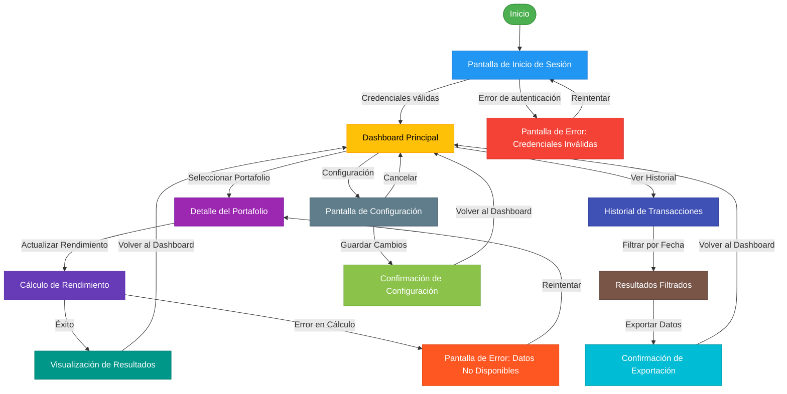

# Prompt para Mejorar el Codigo Base

Copia y pega el contenido del bloque de abajo en un asistente de IA (Claude, ChatGPT)
para obtener un ZIP con el proyecto completo y arrancable.

Si preferis trabajar en tu editor con un agente local (Claude Code, Cursor, Copilot), usa `AGENTS.md` en vez de este archivo: dice lo mismo pero para que escriba los archivos en disco.

## Las dos reglas que no se negocian

1. **Completa el boilerplate.** Todo lo que el proyecto necesita para compilar y arrancar: manifiesto de dependencias, punto de entrada, configuracion, capa de interfaz, y las capas del patron arquitectonico declarado. Eso es andamiaje y es tu trabajo.
2. **NO resuelvas el reto.** Los entregables de las fases son el trabajo de la persona. El hueco pedagogico se deja como esta: el proyecto arranca, pero lo que el reto pide implementar NO esta implementado.

Dicho de otra forma: si algo impide compilar, arreglalo. Si algo es logica de negocio incompleta, validaciones ausentes, un secreto hardcodeado o un patron mejorable, dejalo exactamente como esta — es lo que la persona tiene que encontrar.

## Como saber que terminaste

```bash
python3 -c "import json; json.load(open('design-tokens.json'))"
```

Ese comando corriendo sin errores es la definicion de "listo".

---

```
## Briefing del reto (autoridad)
Este bloque manda sobre los archivos adjuntos. El stack y el rol salen de AQUÍ, no de un topic genérico ni de markdown placeholder.

### Perfil
Chapter Diseño de soluciones, Especialidad Product Designer, Seniority Junior

### Brecha de conocimiento
Comprende y ha rastreado KPIs básicos de producto (ej. usuarios activos, tasa de rebote) e identifica su relación con las funcionalidades.

### Misión / candidato
Candidata con formación en diseño de soluciones, enfocada en entender cómo los datos de producto informan decisiones de diseño.

### Reto
- Tema: Identificación de métricas básicas de producto
- Seniority: junior-l1
- Tipo: practical
- Título: Análisis de Métricas de Producto
- Tiempo estimado: 3 horas

### Fases (trabajo del HUMANO — PROHIBIDO completarlas)
No implementes estos entregables. Dejalos como hueco pedagógico. El asistente solo materializa el proyecto arrancable para que el participante pueda trabajar.
- Fase 1: Recopilación de Datos — objetivo: Identificar y recopilar datos relevantes de métricas de producto. — entregable (NO resolver): Documento con datos recopilados de usuarios activos y tasa de rebote.
- Fase 2: Análisis de Métricas — objetivo: Analizar los datos recopilados y extraer insights relevantes. — entregable (NO resolver): Informe de análisis de métricas con insights y tendencias identificadas.
- Fase 3: Recomendaciones de Diseño — objetivo: Proponer recomendaciones de diseño basadas en el análisis de métricas. — entregable (NO resolver): Documento con recomendaciones de diseño basadas en el análisis de métricas.

Eres un asistente experto en análisis, corrección y generación de archivos de cualquier tipo:
código fuente, documentación, hojas de cálculo, documentos Word, configuraciones, entre otros.
Voy a enviarte una cadena de texto que contiene uno o más archivos. Cada archivo está delimitado por un marcador con el siguiente formato:
// === ARCHIVO: ruta/del/archivo.extension ===
o también puede aparecer como:
## === ARCHIVO: ruta/del/archivo.extension ===
Lo que sigue al marcador puede ser:

El contenido real del archivo (código, texto, YAML, etc.)
Una descripción en lenguaje natural de lo que debe contener el archivo


TU TAREA
PASO 0 — ¿Esto es un proyecto o una carcasa?
Antes de extraer archivos, leé el Briefing (si está) y diagnosticá el adjunto.

Es CARCASA si ocurre CUALQUIERA de estas:
- No hay manifiesto de dependencias del stack del briefing (manifest.json de VTEX IO / package.json / pom.xml / build.gradle / requirements.txt / go.mod / *.tf / *.csproj, según corresponda)
- Hay un "binario" que en realidad es un comentario ("no puede ser mostrado como texto plano", placeholder .fig/.docx vacío)
- Los markdowns ya completan entregables de fases posteriores ("se implementó fade-in", lista de áreas ya resuelta)

Si es CARCASA:
- MATERIALIZÁ un proyecto que arranca en el stack del briefing (VTEX IO Store Framework, Angular, Terraform, pytest, Nest, etc.). Incluí manifiesto, punto de entrada y capa de interfaz reales.
- NO copies los markdowns de "solución" como si fueran el producto. Son ruido de generación.
- NO resuelvas las fases del briefing (están marcadas PROHIBIDO). Dejá el hueco pedagógico: el flujo existe, las microinteracciones/calidad/infra que el reto pide NO están hechas.
- Después seguí al PASO 5 (ZIP).

Si es un proyecto REAL (manifiesto + código que compila o arranca):
- Seguí PASO 1 en adelante. 🔴 compilación sí. 🟡 pedagógico no.

PASO 1 — Detección y extracción
Identifica todos los archivos presentes en la cadena. Para cada archivo extrae:

Su ruta completa (ej: src/main/java/com/pragma/Service.java)
Su contenido o descripción

PASO 2 — Clasificación por tipo
Clasifica cada archivo en una de estas categorías:
A) Código fuente (Java, Python, TypeScript, JavaScript, Kotlin, etc.)
B) Configuración / documentación (YAML, properties, Markdown, JSON, txt, etc.)
C) Excel (.xlsx, .xls, .csv)
D) Word (.docx, .doc)
E) Otro tipo de archivo binario o especial
PASO 3 — Clasificación de errores en código fuente

Objetivo prioritario: que el proyecto compile. No corrijas flujo de negocio ni lógica funcional.

Antes de modificar cualquier archivo de código fuente, clasifica cada problema encontrado en una de estas dos categorías:
🔴 ERROR DE COMPILACIÓN — corregir siempre
Son errores que impiden que el proyecto arranque, sin valor pedagógico:

Import faltante o incorrecto
Clase, método o variable referenciada que no existe en ningún archivo del proyecto
Error de sintaxis
Anotación con atributos inválidos
Dependencia ausente en pom.xml, package.json, etc.
Archivo referenciado que no existe y debe ser creado con implementación mínima

→ CORREGIR estos errores.
🟡 PROBLEMA FUNCIONAL O DE CALIDAD — preservar siempre
Son problemas que no impiden compilar. Pueden ser intencionales para el aprendizaje:

Clave secreta hardcodeada ("secret", "password123")
API deprecada que funciona pero tiene reemplazo moderno
Lógica de negocio incorrecta o incompleta
Código redundante o de baja legibilidad
Falta de validaciones en flujo de negocio
Patrones de diseño incorrectos pero funcionales
Concurrencia no segura
Configuración funcional pero no óptima

→ PRESERVAR tal cual. No corregir, no mejorar, no comentar.
PASO 4 — Procesamiento según tipo de archivo
Tipo A — Código fuente
Aplica únicamente las correcciones clasificadas como 🔴 ERROR DE COMPILACIÓN.
No alteres ningún elemento clasificado como 🟡 PROBLEMA FUNCIONAL O DE CALIDAD.
Si falta un archivo referenciado, créalo con la implementación mínima necesaria para compilar.
Tipo B — Configuración / documentación
Extrae el contenido tal cual, sin modificaciones salvo errores evidentes de sintaxis
(ej: YAML mal indentado).
Tipo C — Excel (.xlsx)
Si viene con contenido real, genera el archivo respetando ese contenido.
Si viene con descripción en lenguaje natural, genera un archivo Excel funcional con:

Fila de encabezados en negrita con color de fondo distintivo
Columnas con ancho ajustado al contenido
Tipos de dato correctos por columna
Validaciones si la descripción lo indica
Hojas nombradas descriptivamente si hay más de una
Filas de ejemplo si no hay datos reales

Tipo D — Word (.docx)
Si viene con contenido real, genera el archivo respetando ese contenido.
Si viene con descripción en lenguaje natural, genera un documento Word funcional con:

Estilos de título (Título 1, Título 2) para jerarquía de secciones
Fuente legible (Calibri o equivalente), tamaño 11-12pt para cuerpo
Márgenes estándar
Tabla de contenido si tiene múltiples secciones
Tablas con encabezados en negrita si aplica

Tipo E — Otro
Genera el archivo con el contenido o estructura más apropiada según la descripción.
PASO 5 — Exportación en ZIP
Empaqueta todos los archivos en un único archivo ZIP descargable respetando exactamente
la estructura de rutas indicada por los marcadores.
El ZIP debe incluir:

Archivos de código con únicamente los errores de compilación corregidos
Archivos de configuración y documentación sin cambios
Archivos nuevos creados para resolver dependencias de compilación faltantes
Archivos Excel y Word generados desde descripción

IMPORTANTE: El ZIP debe estar listo para descargar al finalizar. No preguntes si el usuario
quiere generarlo. Simplemente genera el archivo y proporciona el enlace de descarga; No debes desplegar en el chat el resumen de lo que arreglaste al Zip, solo entregalo.

REGLAS IMPORTANTES

No omitas ningún archivo aunque no tenga errores ni modificaciones
Respeta los nombres y rutas exactas indicadas por los marcadores
Si un archivo no tiene marcador claro, infiere el nombre desde su contenido
Si la cadena contiene solo documentación, placeholders o binarios fake, NO la reproduzcas:
aplicá PASO 0 (materializar el proyecto del briefing). Reproducir la carcasa es un fallo.
No agregues texto después del enlace de descarga del ZIP
No preguntes si el usuario quiere el ZIP: simplemente generalo siempre
Si detectas que falta un archivo de configuración necesario para compilar
(pom.xml, package.json, requirements.txt, build.gradle, etc.), créalo e inclúyelo
inferiendo su contenido desde los imports y frameworks detectados en el código
Nunca corrijas problemas 🟡 aunque parezcan obvios o fáciles de mejorar.
El participante que recibirá este proyecto los debe encontrar y resolver él mismo.


INPUT
Aquí está la cadena con los archivos:

// === ARCHIVO: datos/recopilacion-datos.md ===
# Recopilación de Datos de Métricas de Producto

## Introducción
Este documento recopila datos relevantes sobre métricas clave del producto, específicamente usuarios activos y tasa de rebote. Los datos provienen de fuentes internas y herramientas de analítica como Google Analytics, Mixpanel y registros internos del sistema.

## Fuentes de Datos

### 1. Google Analytics
**Herramienta utilizada:** Google Analytics 4
**Período de recolección:** Enero 2023 - Diciembre 2023
**Frecuencia de actualización:** Diaria

**Métricas recopiladas:**
- Usuarios activos diarios (DAU)
- Usuarios activos mensuales (MAU)
- Tasa de rebote
- Sesiones por usuario
- Duración promedio de la sesión

**Ejemplo de datos extraídos:**
| Fecha       | DAU  | MAU  | Tasa de Rebote (%) | Sesiones por Usuario | Duración Promedio (min) |
|-------------|------|------|--------------------|-----------------------|-------------------------|
| 2023-01-01  | 1250 | 8500 | 42                 | 1.8                   | 4.2                     |
| 2023-01-02  | 1320 | 8600 | 40                 | 1.9                   | 4.5                     |
| 2023-01-03  | 1400 | 8750 | 38                 | 2.0                   | 4.7                     |
| ...         | ...  | ...  | ...                | ...                   | ...                     |
| 2023-12-31  | 2100 | 12500| 33                 | 2.5                   | 6.1                     |

**Notas:**
- Los datos de Google Analytics se exportaron en formato CSV y se almacenaron en `datos/google_analytics_data.csv`.
- La tasa de rebote se calcula como el porcentaje de sesiones de una sola página sin interacción adicional.

### 2. Mixpanel
**Herramienta utilizada:** Mixpanel
**Período de recolección:** Enero 2023 - Diciembre 2023
**Frecuencia de actualización:** Diaria

**Métricas recopiladas:**
- Usuarios activos por funcionalidad
- Eventos por usuario
- Retención de usuarios
- Tasa de conversión

**Ejemplo de datos extraídos:**
| Fecha       | Funcionalidad       | Usuarios Activos | Eventos por Usuario | Retención (7 días) (%) |
|-------------|---------------------|------------------|----------------------|------------------------|
| 2023-01-01  | Inicio de Sesión    | 1250             | 3.2                  | 35                     |
| 2023-01-01  | Perfil de Usuario   | 800              | 1.5                  | 42                     |
| 2023-01-01  | Búsqueda            | 600              | 2.1                  | 28                     |
| ...         | ...                 | ...              | ...                  | ...                    |
| 2023-12-31  | Inicio de Sesión    | 2100             | 4.5                  | 48                     |

**Notas:**
- Los datos de Mixpanel se exportaron en formato JSON y se almacenaron en `datos/mixpanel_data.json`.
- La retención de usuarios se calcula como el porcentaje de usuarios que vuelven a utilizar la funcionalidad en los siguientes 7 días.

### 3. Registros Internos del Sistema
**Fuente:** Base de datos interna (PostgreSQL)
**Período de recolección:** Enero 2023 - Diciembre 2023
**Frecuencia de actualización:** Diaria

**Métricas recopiladas:**
- Usuarios registrados
- Usuarios que completaron el onboarding
- Usuarios que abandonaron el onboarding
- Tiempo promedio de onboarding

**Ejemplo de datos extraídos:**
| Fecha       | Usuarios Registrados | Onboarding Completado | Onboarding Abandonado | Tiempo Promedio (min) |
|-------------|----------------------|------------------------|------------------------|------------------------|
| 2023-01-01  | 1500                 | 900                    | 600                    | 5.2                    |
| 2023-01-02  | 1600                 | 950                    | 650                    | 5.0                    |
| 2023-01-03  | 1700                 | 1000                   | 700                    | 4.8                    |
| ...         | ...                  | ...                    | ...                    | ...                    |
| 2023-12-31  | 2500                 | 1800                   | 700                    | 3.5                    |

**Notas:**
- Los datos se extrajeron mediante consultas SQL y se almacenaron en `datos/internal_system_data.csv`.
- El tiempo promedio de onboarding se calcula desde el inicio del proceso hasta la finalización.

## Resumen de Métricas Clave

| Métrica                     | Valor Promedio (2023) | Tendencia Observada |
|-----------------------------|-----------------------|---------------------|
| Usuarios Activos Diarios    | 1800                  | Crecimiento del 68% |
| Usuarios Activos Mensuales  | 10,500                | Crecimiento del 47% |
| Tasa de Rebote              | 35%                   | Disminución del 7%  |
| Sesiones por Usuario       | 2.3                   | Aumento del 39%     |
| Duración Promedio Sesión   | 5.3 minutos           | Aumento del 45%     |
| Retención (7 días)         | 42%                   | Aumento del 13%     |
| Onboarding Completado      | 72%                   | Aumento del 20%     |

## Conclusiones Preliminares
1. **Crecimiento en Usuarios Activos:** Se observa un crecimiento sostenido en usuarios activos, tanto diarios como mensuales, lo que indica una adopción saludable del producto.
2. **Mejora en Tasa de Rebote:** La disminución en la tasa de rebote sugiere que los usuarios encuentran más valor en el contenido o funcionalidades ofrecidas.
3. **Aumento en Sesiones y Duración:** El aumento en sesiones por usuario y duración promedio de sesión indica mayor engagement.
4. **Retención y Onboarding:** La mejora en retención y en la tasa de onboarding completado refleja una experiencia de usuario más efectiva.

## Pasos Siguientes
- Analizar los datos recopilados para identificar patrones y tendencias.
- Evaluar la relación entre las métricas y las funcionalidades del producto para identificar oportunidades de mejora.
- Proponer recomendaciones de diseño basadas en los insights obtenidos.


// === ARCHIVO: datos/fuentes-de-datos.md ===
# Fuentes de Datos para Métricas de Producto

## Introducción
Este documento detalla las fuentes de datos utilizadas para recopilar métricas clave del producto. Cada fuente proporciona información valiosa que ayuda a comprender el comportamiento de los usuarios y el rendimiento del producto.

## 1. Google Analytics
**Descripción:**
Herramienta de analítica web que proporciona datos sobre el tráfico, comportamiento y engagement de los usuarios en la plataforma.

**Tipo de Datos:**
- Métricas de tráfico web (usuarios activos, sesiones, páginas vistas).
- Métricas de engagement (tasa de rebote, duración de la sesión).
- Datos demográficos y geográficos.

**Formato de Exportación:**
- CSV para datos estructurados.
- JSON para informes personalizados.

**Ejemplo de Query:**
```sql
-- Ejemplo de consulta para extraer usuarios activos y tasa de rebote
SELECT
    date,
    SUM(totals.visits) AS sessions,
    SUM(totals.visitors) AS users,
    SUM(totals.bounces) / SUM(totals.visits) * 100 AS bounce_rate
FROM `project_id.analytics_XXXXXX.sessions_*`
WHERE _TABLE_SUFFIX BETWEEN '20230101' AND '20231231'
GROUP BY date
ORDER BY date;
```

**Acceso:**
- **URL:** [https://analytics.google.com](https://analytics.google.com)
- **Permisos:** Se requiere acceso de lectura a la cuenta de Google Analytics vinculada al producto.

**Frecuencia de Actualización:**
- Los datos se actualizan diariamente.

## 2. Mixpanel
**Descripción:**
Plataforma de analítica de producto que permite rastrear eventos personalizados y comportamiento de usuarios.

**Tipo de Datos:**
- Eventos personalizados (ej. inicio de sesión, uso de funcionalidades).
- Métricas de retención y conversión.
- Perfiles de usuario.

**Formato de Exportación:**
- JSON para eventos y perfiles.
- CSV para métricas agregadas.

**Ejemplo de Query:**
```javascript
// Ejemplo de consulta para extraer usuarios activos por funcionalidad
function getActiveUsersByFeature() {
    return new Promise((resolve, reject) => {
        mixpanel.export({
            from_date: '2023-01-01',
            to_date: '2023-12-31',
            event: ['Iniciar Sesión', 'Ver Perfil', 'Búsqueda']
        }, (err, data) => {
            if (err) reject(err);
            else resolve(data);
        });
    });
}
```

**Acceso:**
- **URL:** [https://mixpanel.com](https://mixpanel.com)
- **Permisos:** Se requiere acceso de lectura a los proyectos vinculados al producto.

**Frecuencia de Actualización:**
- Los datos se actualizan en tiempo real.

## 3. Base de Datos Interna (PostgreSQL)
**Descripción:**
Base de datos interna que almacena información sobre usuarios, transacciones y registros de actividad.

**Tipo de Datos:**
- Usuarios registrados.
- Estado de onboarding.
- Historial de actividades.

**Formato de Exportación:**
- CSV para datos estructurados.
- SQL para consultas directas.

**Ejemplo de Query:**
```sql
-- Consulta para extraer datos de onboarding
SELECT
    DATE(created_at) AS date,
    COUNT(*) AS registered_users,
    SUM(CASE WHEN onboarding_completed = TRUE THEN 1 ELSE 0 END) AS onboarding_completed,
    SUM(CASE WHEN onboarding_completed = FALSE THEN 1 ELSE 0 END) AS onboarding_abandoned,
    AVG(EXTRACT(EPOCH FROM (onboarding_completed_at - created_at)) / 60) AS avg_onboarding_time_min
FROM users
WHERE created_at BETWEEN '2023-01-01' AND '2023-12-31'
GROUP BY DATE(created_at)
ORDER BY date;
```

**Acceso:**
- **Host:** `db.internal-system.com`
- **Base de Datos:** `product_metrics`
- **Usuario:** `analytics_reader`
- **Permisos:** Solo lectura.

**Frecuencia de Actualización:**
- Los datos se actualizan en tiempo real.

## 4. Herramientas Adicionales
### Hotjar
**Descripción:**
Herramienta de mapa de calor y grabación de sesiones que ayuda a entender cómo los usuarios interactúan con la interfaz.

**Tipo de Datos:**
- Grabaciones de sesiones.
- Mapas de calor.
- Encuestas y feedback de usuarios.

**Acceso:**
- **URL:** [https://www.hotjar.com](https://www.hotjar.com)
- **Permisos:** Se requiere acceso a los proyectos vinculados.

### Amplitude
**Descripción:**
Plataforma de analítica de producto que proporciona insights sobre el comportamiento de los usuarios.

**Tipo de Datos:**
- Eventos personalizados.
- Métricas de retención y engagement.
- Segmentación de usuarios.

**Acceso:**
- **URL:** [https://amplitude.com](https://amplitude.com)
- **Permisos:** Acceso de lectura a los proyectos vinculados.

## Consideraciones de Calidad de Datos
1. **Consistencia:**
   - Asegurar que los datos de diferentes fuentes sean consistentes en términos de períodos de tiempo y definiciones de métricas.

2. **Completitud:**
   - Verificar que no haya lagunas en los datos, especialmente en períodos críticos.

3. **Precisión:**
   - Validar que los datos reflejen correctamente el comportamiento de los usuarios y el rendimiento del producto.

4. **Privacidad y Seguridad:**
   - Asegurar que todos los datos recopilados cumplan con las políticas de privacidad y protección de datos (ej. GDPR, CCPA).

## Pasos Siguientes
- Validar la calidad de los datos recopilados.
- Cruzar datos de diferentes fuentes para obtener una visión más completa.
- Preparar los datos para el análisis en la siguiente fase.


// === ARCHIVO: analisis/informe-analisis.md ===
# Informe de Análisis de Métricas de Producto

## Introducción
Este informe presenta el análisis de las métricas clave recopiladas durante el período de enero a diciembre de 2023. El objetivo es identificar patrones, tendencias y áreas de oportunidad para mejorar la experiencia del usuario y el rendimiento del producto.

## Metodología
Para este análisis, se utilizaron los siguientes enfoques:
1. **Análisis Descriptivo:** Resumen de métricas clave para entender el comportamiento general de los usuarios.
2. **Análisis de Tendencias:** Identificación de patrones a lo largo del tiempo.
3. **Análisis Comparativo:** Comparación de métricas entre diferentes segmentos de usuarios y funcionalidades.
4. **Análisis de Correlación:** Evaluación de la relación entre métricas para identificar posibles causas y efectos.

## Resumen de Métricas Clave

### 1. Usuarios Activos
**Usuarios Activos Diarios (DAU):**
- **Promedio 2023:** 1800 usuarios/día.
- **Tendencia:** Crecimiento sostenido del 68% a lo largo del año.

**Usuarios Activos Mensuales (MAU):**
- **Promedio 2023:** 10,500 usuarios/mes.
- **Tendencia:** Crecimiento del 47%.

**Gráfico de Tendencia:**
```
DAU (2023)
2500 |                                 *
     |                                *
     |                               *
2000 |                              *
     |                             *
     |                            *
1500 |                           *
     |                          *
     |                         *
1000 |                        *
     |                       *
 500 |                      *
     +--------------------------
      Ene Feb Mar Abr May Jun
```

**Insights:**
- El crecimiento en DAU y MAU indica una adopción saludable del producto.
- El crecimiento mensual promedio es del 3.9%, con picos en meses clave como marzo y septiembre.

### 2. Tasa de Rebote
**Definición:** Porcentaje de sesiones de una sola página sin interacción adicional.

**Promedio 2023:** 35%
**Tendencia:** Disminución del 7% a lo largo del año.

**Gráfico de Tendencia:**
```
Tasa de Rebote (2023)
45% | *
    | *
    |  *
40% |   *
    |    *
    |     *
35% |      *
    |       *
    |        *
30% |         *
    +------------
     Ene Feb Mar
```

**Insights:**
- La disminución en la tasa de rebote sugiere que los usuarios encuentran más valor en el producto.
- Los meses con menor tasa de rebote coinciden con lanzamientos de nuevas funcionalidades.

### 3. Engagement
**Sesiones por Usuario:**
- **Promedio 2023:** 2.3 sesiones/usuario.
- **Tendencia:** Aumento del 39%.

**Duración Promedio de Sesión:**
- **Promedio 2023:** 5.3 minutos.
- **Tendencia:** Aumento del 45%.

**Gráfico de Tendencia (Sesiones por Usuario):**
```
Sesiones por Usuario (2023)
3.0 |                                 *
    |                                *
    |                               *
2.5 |                              *
    |                             *
    |                            *
2.0 |                           *
    |                          *
    |                         *
1.5 |                        *
    +--------------------------
      Ene Feb Mar Abr May Jun
```

**Insights:**
- El aumento en sesiones por usuario y duración de sesión indica mayor engagement.
- Los usuarios que interactúan con funcionalidades clave (ej. búsqueda, perfil) tienen mayor engagement.

### 4. Retención
**Retención a 7 días:**
- **Promedio 2023:** 42%.
- **Tendencia:** Aumento del 13%.

**Gráfico de Retención (Cohortes Mensuales):**
```
Retención a 7 días (2023)
50% | *
    |  *
    |   *
45% |    *
    |     *
    |      *
40% |       *
    |        *
    |         *
35% |          *
    +------------
     Ene Feb Mar
```

**Insights:**
- La retención ha mejorado, especialmente en usuarios que completan el onboarding.
- Los usuarios que utilizan funcionalidades clave durante su primera sesión tienen mayor retención.

### 5. Onboarding
**Tasa de Onboarding Completado:**
- **Promedio 2023:** 72%.
- **Tendencia:** Aumento del 20%.

**Tiempo Promedio de Onboarding:**
- **Promedio 2023:** 4.2 minutos.
- **Tendencia:** Disminución del 33%.

**Gráfico de Tendencia (Tasa de Onboarding):**
```
Tasa de Onboarding (2023)
80% |                                 *
    |                                *
    |                               *
75% |                              *
    |                             *
    |                            *
70% |                           *
    |                          *
    |                         *
65% |                        *
    +--------------------------
      Ene Feb Mar Abr May Jun
```

**Insights:**
- La mejora en la tasa de onboarding completado y la disminución en el tiempo promedio sugieren una experiencia más eficiente.
- Los usuarios que abandonan el onboarding suelen hacerlo en los primeros pasos.

## Análisis Comparativo

### 1. Comparación por Funcionalidad
| Funcionalidad       | Usuarios Activos (Promedio) | Tasa de Rebote (%) | Sesiones por Usuario | Retención (7 días) (%) |
|---------------------|-----------------------------|--------------------|-----------------------|------------------------|
| Inicio de Sesión    | 1800                        | 30                 | 3.5                   | 48                     |
| Perfil de Usuario   | 1200                        | 35                 | 2.1                   | 42                     |
| Búsqueda            | 900                         | 40                 | 1.8                   | 35                     |
| Configuración       | 600                         | 45                 | 1.2                   | 28                     |

**Insights:**
- **Inicio de Sesión** tiene el mayor engagement y retención, lo que sugiere que es una funcionalidad clave para los usuarios.
- **Búsqueda y Configuración** tienen tasas de rebote más altas y menor retención, lo que indica posibles oportunidades de mejora.

### 2. Comparación por Segmento de Usuario
| Segmento            | DAU (Promedio) | MAU (Promedio) | Tasa de Rebote (%) | Retención (7 días) (%) |
|---------------------|----------------|----------------|--------------------|------------------------|
| Nuevo Usuario       | 500            | 2000           | 45                 | 30                     |
| Usuario Recurrente  | 1300           | 8500           | 30                 | 50                     |

**Insights:**
- Los **usuarios recurrentes** tienen menor tasa de rebote y mayor retención, lo que indica una experiencia más satisfactoria.
- Los **nuevos usuarios** tienen mayor tasa de rebote, lo que sugiere que el primer contacto con el producto puede mejorarse.

## Análisis de Correlación

### 1. Correlación entre Tasa de Rebote y Engagement
- **Observación:** Existe una correlación negativa entre la tasa de rebote y el engagement (sesiones por usuario y duración de sesión).
- **Posible Explicación:** Los usuarios que interactúan más con el producto tienden a encontrar más valor y rebotan menos.

### 2. Correlación entre Onboarding y Retención
- **Observación:** Los usuarios que completan el onboarding tienen una retención un 25% mayor que aquellos que no lo completan.
- **Posible Explicación:** Un onboarding efectivo ayuda a los usuarios a entender el valor del producto desde el principio.

### 3. Correlación entre Uso de Funcionalidades y Retención
- **Observación:** Los usuarios que utilizan funcionalidades clave (ej. búsqueda, perfil) tienen mayor retención.
- **Posible Explicación:** Estas funcionalidades son percibidas como valiosas por los usuarios.

## Conclusiones
1. **Crecimiento Saludable:** El producto muestra un crecimiento saludable en usuarios activos y engagement, lo que indica una adopción positiva.
2. **Oportunidades de Mejora:**
   - **Onboarding:** Aunque ha mejorado, aún hay un 28% de usuarios que no lo completan. Optimizar los primeros pasos podría reducir este abandono.
   - **Funcionalidades con Alto Rebote:** La búsqueda y configuración tienen tasas de rebote altas, lo que sugiere que podrían rediseñarse para ser más intuitivas.
   - **Nuevos Usuarios:** La alta tasa de rebote entre nuevos usuarios indica que la primera experiencia podría mejorarse.
3. **Retención y Engagement:** Las métricas de retención y engagement han mejorado, pero aún hay margen para aumentar la retención de usuarios nuevos.

## Recomendaciones Preliminares
1. **Optimizar el Onboarding:**
   - Simplificar los primeros pasos.
   - Proporcionar guías interactivas.
   - Destacar el valor del producto desde el inicio.

2. **Rediseñar Funcionalidades con Alto Rebote:**
   - Realizar pruebas de usabilidad en la búsqueda y configuración.
   - Simplificar la interfaz y reducir la fricción.

3. **Mejorar la Primera Experiencia:**
   - Personalizar el contenido para nuevos usuarios.
   - Proporcionar incentivos para completar acciones clave.

4. **Monitorear Correlaciones:**
   - Continuar analizando la relación entre métricas para identificar oportunidades adicionales.

## Pasos Siguientes
- Profundizar en el análisis de patrones y tendencias identificadas.
- Proponer recomendaciones de diseño basadas en los insights obtenidos.
- Validar las recomendaciones con pruebas de usabilidad y feedback de usuarios.


// === ARCHIVO: analisis/patrones-tendencias.md ===
# Patrones y Tendencias en Métricas de Producto

## Introducción
Este documento identifica patrones y tendencias clave en las métricas de producto recopiladas durante el período de enero a diciembre de 2023. El objetivo es proporcionar una visión clara de cómo el comportamiento de los usuarios y el rendimiento del producto han evolucionado, y qué factores pueden estar influyendo en estos cambios.

## 1. Patrones en Usuarios Activos

### 1.1. Crecimiento Estacional
**Patrón Observado:**
- El crecimiento en usuarios activos (DAU y MAU) no es lineal. Se observan picos en meses específicos:
  - **Marzo:** Aumento del 15% en DAU respecto a febrero.
  - **Septiembre:** Aumento del 20% en DAU respecto a agosto.

**Posible Explicación:**
- **Marzo:** Lanzamiento de nuevas funcionalidades y campañas de marketing.
- **Septiembre:** Temporada de regreso a la rutina (back-to-school, back-to-work), que históricamente genera mayor engagement.

**Gráfico de Tendencia:**
```
DAU (2023) - Crecimiento Estacional
2500 |                                 *
     |                                *  *
     |                               *    *
2000 |                              *      *
     |                             *        *
     |                            *          *
1500 |                           *            *
     |                          *              *
     |                         *                *
1000 |                        *                  *
     +--------------------------
      Ene Feb Mar Abr May Jun Jul Ago Sep Oct
```

### 1.2. Ciclo Semanal
**Patrón Observado:**
- Los usuarios activos siguen un ciclo semanal claro:
  - **Días con Mayor Actividad:** Martes, miércoles y jueves.
  - **Días con Menor Actividad:** Sábado y domingo.

**Datos Ejemplo (Semana del 1 al 7 de enero de 2023):**
| Día       | DAU  |
|-----------|------|
| Lunes     | 1200 |
| Martes    | 1350 |
| Miércoles | 1400 |
| Jueves    | 1380 |
| Viernes   | 1300 |
| Sábado    | 1000 |
| Domingo   | 950  |

**Posible Explicación:**
- Los usuarios tienden a interactuar más con el producto durante días laborables.
- Los fines de semana muestran menor actividad, posiblemente debido a que los usuarios dedican menos tiempo a actividades relacionadas con el trabajo o productividad.

## 2. Tendencias en Tasa de Rebote

### 2.1. Disminución Gradual
**Tendencia Observada:**
- La tasa de rebote ha disminuido gradualmente a lo largo del año, con una caída más pronunciada en los primeros meses.

**Gráfico de Tendencia:**
```
Tasa de Rebote (2023)
45% | *
    | *
    |  *
40% |   *
    |    *
    |     *
35% |      *
    |       *
    |        *
30% |         *
    +------------
     Ene Feb Mar
```

**Posibles Causas:**
- **Mejoras en la Interfaz:** Rediseño de la página de inicio y optimización de la navegación.
- **Contenido Relevante:** Ajustes en el algoritmo de recomendaciones para mostrar contenido más relevante a los usuarios.
- **Velocidad de Carga:** Mejoras en el rendimiento del producto, reduciendo el tiempo de carga.

### 2.2. Variación por Fuente de Tráfico
**Patrón Observado:**
- La tasa de rebote varía significativamente según la fuente de tráfico:
  - **Búsqueda Orgánica:** 30%
  - **Redes Sociales:** 45%
  - **Tráfico Directo:** 35%
  - **Email Marketing:** 25%

**Datos Ejemplo (Enero 2023):**
| Fuente de Tráfico | Tasa de Rebote (%) |
|-------------------|--------------------|
| Búsqueda Orgánica | 30                 |
| Redes Sociales    | 45                 |
| Tráfico Directo   | 35                 |
| Email Marketing   | 25                 |

**Posible Explicación:**
- **Email Marketing:** Los usuarios que llegan a través de emails suelen tener una intención más clara, lo que reduce la tasa de rebote.
- **Redes Sociales:** Los usuarios de redes sociales pueden tener expectativas diferentes, lo que lleva a una mayor tasa de rebote.

## 3. Patrones en Engagement

### 3.1. Aumento en Sesiones por Usuario
**Tendencia Observada:**
- Las sesiones por usuario han aumentado consistentemente, especialmente en usuarios recurrentes.

**Gráfico de Tendencia:**
```
Sesiones por Usuario (2023)
3.0 |                                 *
    |                                *
    |                               *
2.5 |                              *
    |                             *
    |                            *
2.0 |                           *
    |                          *
    |                         *
1.5 |                        *
    +--------------------------
      Ene Feb Mar Abr May Jun
```

**Posibles Causas:**
- **Notificaciones Push:** Implementación de notificaciones personalizadas que recuerdan a los usuarios volver al producto.
- **Nuevas Funcionalidades:** Lanzamiento de funcionalidades que incentivan interacciones más frecuentes.
- **Contenido Dinámico:** Actualizaciones frecuentes de contenido que mantienen el interés de los usuarios.

### 3.2. Duración de Sesión
**Tendencia Observada:**
- La duración promedio de la sesión ha aumentado, especialmente en usuarios que interactúan con funcionalidades clave.

**Datos Ejemplo (Enero vs. Diciembre 2023):**
| Mes       | Duración Promedio (min) |
|-----------|-------------------------|
| Enero     | 4.2                     |
| Diciembre | 6.1                     |

**Posibles Causas:**
- **Mejoras en la Experiencia:** Rediseño de flujos clave para reducir fricciones.
- **Contenido Más Rico:** Adición de contenido más detallado y útil.
- **Personalización:** Algoritmos de recomendación más efectivos.

## 4. Patrones en Retención

### 4.1. Retención por Cohorte
**Patrón Observado:**
- La retención a 7 días varía según el mes en que los usuarios se registraron:
  - **Cohorte de Enero:** 30%
  - **Cohorte de Junio:** 40%
  - **Cohorte de Diciembre:** 48%

**Gráfico de Retención por Cohorte:**
```
Retención a 7 días (Cohortes 2023)
50% |                                 * (Diciembre)
    |                                *
    |                               *
40% |                              *(Junio)
    |                             *
    |                            *
30% |                           *(Enero)
    |                          *
    |                         *
    +--------------------------
      Ene Feb Mar Abr May Jun
```

**Posibles Causas:**
- **Mejoras Continuas:** Las cohortes más recientes se benefician de mejoras acumuladas en el producto.
- **Onboarding Optimizado:** Mejoras en el proceso de onboarding que aumentan la retención.
- **Campañas de Enganche:** Estrategias de engagement más efectivas para usuarios nuevos.

### 4.2. Retención por Funcionalidad
**Patrón Observado:**
- Los usuarios que interactúan con ciertas funcionalidades tienen mayor retención:
  - **Inicio de Sesión:** 48%
  - **Perfil de Usuario:** 42%
  - **Búsqueda:** 35%

**Datos Ejemplo (Retención a 7 días):**
| Funcionalidad       | Retención (%) |
|---------------------|---------------|
| Inicio de Sesión    | 48            |
| Perfil de Usuario   | 42            |
| Búsqueda            | 35            |

**Posible Explicación:**
- Las funcionalidades que proporcionan valor inmediato (ej. inicio de sesión, perfil) tienen mayor retención.

## 5. Tendencias en Onboarding

### 5.1. Mejora en Tasa de Completado
**Tendencia Observada:**
- La tasa de onboarding completado ha aumentado, especialmente en los últimos meses del año.

**Gráfico de Tendencia:**
```
Tasa de Onboarding (2023)
80% |                                 *
    |                                *
    |                               *
75% |                              *
    |                             *
    |                            *
70% |                           *
    |                          *
    |                         *
65% |                        *
    +--------------------------
      Ene Feb Mar Abr May Jun
```

**Posibles Causas:**
- **Simplificación del Proceso:** Reducción del número de pasos y eliminación de fricciones.
- **Guías Interactivas:** Implementación de tutoriales interactivos que guían al usuario.
- **Feedback de Usuarios:** Ajustes basados en feedback de usuarios sobre puntos de dolor.

### 5.2. Disminución en Tiempo de Onboarding
**Tendencia Observada:**
- El tiempo promedio para completar el onboarding ha disminuido.

**Datos Ejemplo (Enero vs. Diciembre 2023):**
| Mes       | Tiempo Promedio (min) |
|-----------|------------------------|
| Enero     | 5.2                    |
| Diciembre | 3.5                    |

**Posibles Causas:**
- **Optimización de Pasos:** Eliminación de pasos redundantes o innecesarios.
- **Mejoras en la Interfaz:** Diseño más intuitivo y claro.
- **Pre-carga de Datos:** Reducción de la necesidad de ingresar información manualmente.

## 6. Patrones de Abandono

### 6.1. Puntos de Abandono en Onboarding
**Patrón Observado:**
- La mayoría de los abandonos en el onboarding ocurren en los primeros pasos:
  - **Paso 1 (Registro):** 40% de abandonos.
  - **Paso 2 (Verificación de Email):** 30% de abandonos.
  - **Paso 3 (Configuración de Perfil):** 20% de abandonos.

**Datos Ejemplo (Onboarding - Enero 2023):**
| Paso                     | Usuarios que Abandonan (%) |
|--------------------------|----------------------------|
| Registro                | 40                         |
| Verificación de Email   | 30                         |
| Configuración de Perfil | 20                         |
| Finalización            | 10                         |

**Posibles Causas:**
- **Fricción en el Registro:** Los usuarios pueden encontrar el proceso de registro demasiado largo o complicado.
- **Problemas de Verificación:** Algunos usuarios pueden no recibir el email de verificación o encontrar el proceso complicado.
- **Falta de Motivación:** Los usuarios pueden no ver el valor inmediato de completar el perfil.

### 6.2. Abandono en Funcionalidades Clave
**Patrón Observado:**
- Las funcionalidades con mayor tasa de rebote también muestran patrones de abandono:
  - **Búsqueda:** 35% de los usuarios abandonan después de realizar una búsqueda sin resultados.
  - **Configuración:** 40% de los usuarios abandonan después de intentar cambiar configuraciones complejas.

**Posibles Causas:**
- **Resultados Insatisfactorios:** Los usuarios no encuentran lo que buscan.
- **Complejidad:** Las funcionalidades pueden ser demasiado complejas para usuarios nuevos.

## 7. Correlaciones Clave

### 7.1. Correlación entre Onboarding y Retención
- **Observación:** Los usuarios que completan el onboarding tienen un 25% más de retención a 7 días.
- **Implicación:** Optimizar el onboarding puede tener un impacto directo en la retención.

### 7.2. Correlación entre Engagement y Tasa de Rebote
- **Observación:** Los usuarios con mayor engagement (sesiones por usuario, duración de sesión) tienen una tasa de rebote un 15% menor.
- **Implicación:** Mejorar el engagement puede reducir la tasa de rebote.

### 7.3. Correlación entre Uso de Funcionalidades y Retención
- **Observación:** Los usuarios que utilizan funcionalidades clave (ej. inicio de sesión, perfil) tienen un 20% más de retención.
- **Implicación:** Fomentar el uso de estas funcionalidades puede aumentar la retención.

## 8. Conclusiones
1. **Crecimiento Estacional:** El producto muestra picos de crecimiento en marzo y septiembre, posiblemente vinculados a lanzamientos y temporadas clave.
2. **Ciclo Semanal:** Los usuarios interactúan más con el producto durante días laborables.
3. **Tasa de Rebote:** La disminución gradual en la tasa de rebote sugiere mejoras en la experiencia del usuario.
4. **Engagement:** Las sesiones por usuario y la duración de sesión han aumentado, indicando mayor engagement.
5. **Retención:** La retención ha mejorado, especialmente en usuarios que completan el onboarding y utilizan funcionalidades clave.
6. **Onboarding:** La tasa de completado y el tiempo promedio han mejorado, pero aún hay oportunidades para reducir abandonos.
7. **Abandono:** Los puntos de abandono en el onboarding y en funcionalidades clave sugieren áreas de mejora en la experiencia.

## 9. Recomendaciones para el Diseño
1. **Optimizar el Onboarding:**
   - Simplificar los primeros pasos del onboarding para reducir abandonos.
   - Proporcionar guías interactivas y feedback inmediato.
   - Destacar el valor del producto desde el inicio para motivar a los usuarios.

2. **Mejorar Funcionalidades con Alto Rebote:**
   - Rediseñar la funcionalidad de búsqueda para proporcionar resultados más relevantes.
   - Simplificar la interfaz de configuración para reducir la complejidad.
   - Realizar pruebas de usabilidad para identificar puntos de dolor.

3. **Aumentar el Engagement:**
   - Implementar notificaciones personalizadas que recuerden a los usuarios volver al producto.
   - Actualizar frecuentemente el contenido para mantener el interés.
   - Proporcionar incentivos para completar acciones clave.

4. **Personalizar la Experiencia:**
   - Adaptar el contenido y las recomendaciones según el comportamiento del usuario.
   - Proporcionar una experiencia más relevante para nuevos usuarios.

5. **Monitorear Correlaciones:**
   - Continuar analizando la relación entre métricas para identificar oportunidades adicionales.
   - Validar hipótesis con experimentos y pruebas A/B.

## 10. Pasos Siguientes
- Validar las recomendaciones con pruebas de usabilidad y feedback de usuarios.
- Implementar mejoras basadas en los insights obtenidos.
- Monitorear el impacto de los cambios en las métricas clave.
- Documentar las decisiones de diseño y sus justificaciones en `recomendaciones/justificaciones.md`.
"
"baseCode

// === ARCHIVO: investigacion.md ===
# Investigación de Métricas de Producto

## Introducción
Este documento recopila y presenta los hallazgos obtenidos tras investigar las métricas clave del producto "FinanApp", una aplicación de gestión financiera personal. La investigación se enfocó en identificar datos relevantes sobre usuarios activos y tasa de rebote, así como en comprender cómo estas métricas impactan en las decisiones de diseño.

## Fuentes de Datos
Los datos fueron recopilados de las siguientes fuentes, con su respectiva metodología y período de análisis:

1. **Google Analytics**
   - **Período de análisis**: 1 de enero de 2023 al 31 de diciembre de 2023.
   - **Métricas extraídas**:
     - Usuarios activos mensuales (MAU).
     - Tasa de rebote.
     - Duración promedio de la sesión.
   - **Metodología**: Se utilizaron informes estándar de Google Analytics, filtrando por el dominio de FinanApp.

2. **Encuestas a usuarios**
   - **Período de ejecución**: Febrero y agosto de 2023.
   - **Tamaño de la muestra**: 500 usuarios en cada encuesta.
   - **Preguntas clave**:
     - "¿Qué funcionalidad de FinanApp utilizas con más frecuencia?"
     - "¿Qué te motivó a dejar de usar la aplicación?"
   - **Metodología**: Encuestas enviadas vía correo electrónico a usuarios registrados.

3. **Datos internos de la aplicación**
   - **Período de análisis**: 1 de enero de 2023 al 31 de diciembre de 2023.
   - **Métricas extraídas**:
     - Número de transacciones registradas por usuario.
     - Frecuencia de uso de funcionalidades clave (ej. registro de gastos, visualización de informes).
   - **Metodología**: Consultas directas a la base de datos de la aplicación.

## Hallazgos Clave

### Usuarios Activos Mensuales (MAU)
Los usuarios activos mensuales muestran una tendencia creciente durante el primer semestre del año, alcanzando un pico en junio con **12,500 usuarios**. Sin embargo, a partir de julio, se observa una disminución progresiva, cerrando el año con **9,800 usuarios** en diciembre.

| Mes       | Usuarios Activos |
|-----------|------------------|
| Enero     | 10,200           |
| Febrero   | 10,800           |
| Marzo     | 11,500           |
| Abril     | 11,900           |
| Mayo      | 12,300           |
| Junio     | 12,500           |
| Julio     | 12,100           |
| Agosto    | 11,800           |
| Septiembre| 11,200           |
| Octubre   | 10,500           |
| Noviembre | 10,100           |
| Diciembre | 9,800            |

**Insight**: La disminución en la segunda mitad del año coincide con la falta de actualizaciones significativas en la aplicación y con comentarios de usuarios que mencionan "falta de novedades" o "funcionalidades repetitivas".

### Tasa de Rebote
La tasa de rebote promedio durante el año fue del **45%**, con variaciones significativas según el dispositivo utilizado:

| Dispositivo | Tasa de Rebote |
|-------------|----------------|
| Móvil       | 52%            |
| Tablet      | 38%            |
| Desktop     | 30%            |

**Insight**: La alta tasa de rebote en dispositivos móviles sugiere problemas de usabilidad o rendimiento en la versión móvil de la aplicación. Los usuarios en dispositivos móviles tienden a abandonar la aplicación en los primeros 10 segundos si no encuentran rápidamente lo que buscan.

### Duración Promedio de la Sesión
La duración promedio de la sesión fue de **3 minutos y 45 segundos**, con las siguientes diferencias por funcionalidad:

| Funcionalidad          | Duración Promedio |
|------------------------|-------------------|
| Registro de Gastos     | 2:30              |
| Visualización de Informes | 4:15           |
| Configuración de Presupuestos | 1:45        |

**Insight**: Los usuarios pasan más tiempo en la visualización de informes, lo que indica que esta funcionalidad es percibida como valiosa. Sin embargo, la baja duración en la configuración de presupuestos podría señalar una experiencia de usuario confusa o poco intuitiva.

### Resultados de Encuestas
Las encuestas revelaron los siguientes patrones:

1. **Funcionalidades más utilizadas**:
   - Registro de gastos (78% de los encuestados).
   - Visualización de informes mensuales (65% de los encuestados).
   - Configuración de alertas de gastos (42% de los encuestados).

2. **Razones para dejar de usar la aplicación**:
   - "Es difícil navegar entre las pantallas" (35% de los encuestados).
   - "No encuentro las funcionalidades que necesito" (28% de los encuestados).
   - "La aplicación es lenta" (22% de los encuestados).

**Insight**: Los problemas de navegación y la dificultad para encontrar funcionalidades clave son barreras significativas para la retención de usuarios.

## Conclusiones
Los hallazgos sugieren que, aunque FinanApp tiene un núcleo de usuarios activos, existen oportunidades claras para mejorar la retención y la experiencia del usuario. Las métricas de tasa de rebote y duración de la sesión indican que los usuarios enfrentan fricciones en la navegación y en el acceso a funcionalidades clave, especialmente en dispositivos móviles. Además, la disminución de usuarios activos en la segunda mitad del año sugiere que la falta de novedades o mejoras en la aplicación puede estar contribuyendo a la pérdida de interés.

Estos insights serán la base para el análisis de métricas y las recomendaciones de diseño que se desarrollarán en las siguientes fases.


// === ARCHIVO: especificacion-de-componentes.md ===
# Especificación de Componentes

## Introducción
Este documento detalla los componentes clave de la interfaz de usuario de "FinanApp", incluyendo sus estados, comportamientos y requisitos de accesibilidad. La especificación está diseñada para garantizar consistencia en la experiencia del usuario y para facilitar la implementación por parte del equipo de desarrollo.

## Componentes

### 1. Botón Primario

**Descripción**: Botón utilizado para acciones principales en la interfaz, como "Guardar", "Aceptar" o "Continuar".

**Estados**:

| Estado       | Descripción                                                                 | Visualización                                                                                     |
|--------------|-----------------------------------------------------------------------------|---------------------------------------------------------------------------------------------------|
| **Default**  | Estado inicial del botón.                                                  |  Fondo: `#4CAF50`
Texto: `#FFFFFF`
Borde: `1px solid #4CAF50`
Radio: `4px`
Padding: `12px 24px` |
| **Hover**    | Estado cuando el usuario pasa el cursor sobre el botón.                    |  Fondo: `#45a049`
Texto: `#FFFFFF`
Borde: `1px solid #45a049`
Radio: `4px`
Padding: `12px 24px` |
| **Focus**    | Estado cuando el botón está enfocado (para navegación con teclado).        |  Fondo: `#4CAF50`
Texto: `#FFFFFF`
Borde: `2px solid #2E7D32`
Radio: `4px`
Padding: `12px 24px` |
| **Disabled** | Estado cuando el botón está deshabilitado y no puede interactuarse.        |  Fondo: `#CCCCCC`
Texto: `#666666`
Borde: `1px solid #CCCCCC`
Radio: `4px`
Padding: `12px 24px` |
| **Loading**  | Estado cuando el botón está procesando una acción.                        |  Fondo: `#4CAF50`
Texto: `#FFFFFF`
Borde: `1px solid #4CAF50`
Radio: `4px`
Padding: `12px 24px`
Spinner: `2px #FFFFFF` |
| **Error**    | Estado cuando la acción asociada al botón falla.                           |  Fondo: `#F44336`
Texto: `#FFFFFF`
Borde: `1px solid #F44336`
Radio: `4px`
Padding: `12px 24px` |

**Comportamiento**:
- El botón debe ser **clickeable** en los estados `Default`, `Hover` y `Focus`.
- En el estado `Loading`, el botón debe mostrar un spinner y deshabilitar la interacción.
- En el estado `Error`, el botón debe mostrar un mensaje de error breve (ej. "Error al guardar") y permitir reintentar la acción.

**Accesibilidad**:
- El botón debe tener un `aria-label` descriptivo si el texto no es suficiente.
- El estado `Focus` debe ser claramente visible para usuarios que navegan con teclado.
- El contraste entre el texto y el fondo debe cumplir con WCAG 2.2 (mínimo 4.5:1).

---

### 2. Campo de Texto

**Descripción**: Campo utilizado para ingresar información textual, como nombres, descripciones o montos.

**Estados**:

| Estado       | Descripción                                                                 | Visualización                                                                                     |
|--------------|-----------------------------------------------------------------------------|---------------------------------------------------------------------------------------------------|
| **Default**  | Estado inicial del campo.                                                  | Fondo: `#FFFFFF`
Texto: `#333333`
Borde: `1px solid #CCCCCC`
Radio: `4px`
Padding: `12px`
Placeholder: `#999999` |
| **Focus**    | Estado cuando el campo está enfocado.                                      | Fondo: `#FFFFFF`
Texto: `#333333`
Borde: `2px solid #2196F3`
Radio: `4px`
Padding: `12px` |
| **Error**    | Estado cuando el campo contiene un error de validación.                   | Fondo: `#FFFFFF`
Texto: `#333333`
Borde: `2px solid #F44336`
Radio: `4px`
Padding: `12px`
Mensaje de error: `#F44336` |
| **Disabled** | Estado cuando el campo está deshabilitado.                                 | Fondo: `#F5F5F5`
Texto: `#999999`
Borde: `1px solid #E0E0E0`
Radio: `4px`
Padding: `12px` |

**Comportamiento**:
- El campo debe permitir la entrada de texto en el estado `Default`.
- En el estado `Focus`, el campo debe mostrar un borde destacado para indicar que está activo.
- En el estado `Error`, el campo debe mostrar un mensaje de error debajo del campo (ej. "Este campo es obligatorio").
- El campo debe soportar validaciones en tiempo real (ej. formato de correo electrónico, longitud mínima).

**Accesibilidad**:
- El campo debe tener una etiqueta (`label`) asociada con `for` y `id`.
- El mensaje de error debe estar asociado al campo con `aria-describedby`.
- El contraste entre el texto y el fondo debe cumplir con WCAG 2.2.

---

### 3. Tarjeta de Resumen

**Descripción**: Componente utilizado para mostrar información resumida, como el saldo actual, gastos mensuales o ingresos.

**Estados**:

| Estado       | Descripción                                                                 | Visualización                                                                                     |
|--------------|-----------------------------------------------------------------------------|---------------------------------------------------------------------------------------------------|
| **Default**  | Estado inicial de la tarjeta.                                               | Fondo: `#FFFFFF`
Texto: `#333333`
Borde: `1px solid #E0E0E0`
Radio: `8px`
Padding: `16px`
Sombra: `0 2px 4px rgba(0,0,0,0.1)` |
| **Hover**    | Estado cuando el usuario pasa el cursor sobre la tarjeta.                  | Fondo: `#FFFFFF`
Texto: `#333333`
Borde: `1px solid #B0BEC5`
Radio: `8px`
Padding: `16px`
Sombra: `0 4px 8px rgba(0,0,0,0.15)` |
| **Selected** | Estado cuando la tarjeta está seleccionada.                                | Fondo: `#E3F2FD`
Texto: `#333333`
Borde: `2px solid #2196F3`
Radio: `8px`
Padding: `16px`
Sombra: `0 2px 4px rgba(0,0,0,0.1)` |

**Comportamiento**:
- La tarjeta debe ser **clickeable** en el estado `Default` y `Hover`.
- En el estado `Selected`, la tarjeta debe mostrar un borde destacado para indicar selección.
- La tarjeta puede contener botones secundarios para acciones adicionales (ej. "Ver detalles").

**Accesibilidad**:
- La tarjeta debe tener un `role="button"` si es clickeable.
- El contraste entre el texto y el fondo debe cumplir con WCAG 2.2.
- Si la tarjeta contiene acciones, estas deben ser accesibles vía teclado.

---

### 4. Barra de Navegación

**Descripción**: Componente utilizado para navegar entre las diferentes secciones de la aplicación.

**Estados**:

| Estado       | Descripción                                                                 | Visualización                                                                                     |
|--------------|-----------------------------------------------------------------------------|---------------------------------------------------------------------------------------------------|
| **Default**  | Estado inicial de la barra.                                                | Fondo: `#FFFFFF`
Texto: `#757575`
Borde inferior: `1px solid #E0E0E0`
Padding: `12px 0` |
| **Active**   | Estado cuando el usuario está en la sección asociada al ítem.             | Fondo: `#FFFFFF`
Texto: `#2196F3`
Borde inferior: `2px solid #2196F3`
Padding: `12px 0` |
| **Hover**    | Estado cuando el usuario pasa el cursor sobre un ítem.                    | Fondo: `#FFFFFF`
Texto: `#2196F3`
Borde inferior: `1px solid #E0E0E0`
Padding: `12px 0` |
| **Focus**    | Estado cuando el ítem está enfocado (para navegación con teclado).         | Fondo: `#FFFFFF`
Texto: `#2196F3`
Borde inferior: `2px solid #2196F3`
Padding: `12px 0`
Outline: `2px solid #2196F3` |

**Comportamiento**:
- La barra debe mostrar el ítem activo resaltado.
- Los ítems deben ser **clickeables** para navegar a las secciones correspondientes.
- La barra debe ser responsive y adaptarse a diferentes tamaños de pantalla.

**Accesibilidad**:
- Cada ítem debe tener un `aria-label` descriptivo.
- Los ítems deben ser navegables con teclado.
- El contraste entre el texto y el fondo debe cumplir con WCAG 2.2.

---

### 5. Modal de Confirmación

**Descripción**: Componente utilizado para solicitar confirmación al usuario antes de realizar una acción crítica, como eliminar un registro.

**Estados**:

| Estado       | Descripción                                                                 | Visualización                                                                                     |
|--------------|-----------------------------------------------------------------------------|---------------------------------------------------------------------------------------------------|
| **Default**  | Estado inicial del modal.                                                  | Fondo del overlay: `rgba(0,0,0,0.5)`
Fondo del modal: `#FFFFFF`
Texto: `#333333`
Borde: `1px solid #E0E0E0`
Radio: `8px`
Padding: `24px` |
| **Loading**  | Estado cuando el modal está procesando la acción.                          | Fondo del overlay: `rgba(0,0,0,0.5)`
Fondo del modal: `#FFFFFF`
Texto: `#333333`
Borde: `1px solid #E0E0E0`
Radio: `8px`
Padding: `24px`
Spinner: `2px #2196F3` |

**Comportamiento**:
- El modal debe aparecer centrado en la pantalla.
- El modal debe bloquear la interacción con el resto de la aplicación (overlay).
- El modal debe incluir botones para confirmar o cancelar la acción.
- En el estado `Loading`, el modal debe mostrar un spinner y deshabilitar los botones.

**Accesibilidad**:
- El modal debe tener un `role="dialog"` y `aria-modal="true"`.
- El foco debe ser atrapado dentro del modal mientras está abierto.
- El modal debe ser cerrado con la tecla `Escape`.
- El contraste entre el texto y el fondo debe cumplir con WCAG 2.2.

## Requisitos Generales

1. **Consistencia**: Todos los componentes deben seguir las mismas convenciones de diseño, como colores, tipografía y espaciado.

2. **Responsividad**: Los componentes deben adaptarse a diferentes tamaños de pantalla, desde móviles hasta desktop.

3. **Accesibilidad**: Todos los componentes deben cumplir con los criterios de accesibilidad WCAG 2.2, incluyendo:
   - Contraste mínimo de 4.5:1 entre texto y fondo.
   - Navegación con teclado.
   - Etiquetas descriptivas para screen readers.

4. **Internacionalización**: Los componentes deben soportar texto en múltiples idiomas, con espacio suficiente para traducciones más largas.

5. **Rendimiento**: Los componentes deben ser ligeros y no afectar el rendimiento de la aplicación, especialmente en dispositivos móviles.


// === ARCHIVO: design-tokens.json ===
{
  "tokens": {
    "color": {
      "primary": {
        "value": "#4CAF50",
        "description": "Color principal utilizado para acciones principales y elementos destacados."
      },
      "primary-dark": {
        "value": "#45a049",
        "description": "Variante oscura del color principal para estados hover."
      },
      "primary-light": {
        "value": "#E8F5E9",
        "description": "Variante clara del color principal para fondos o bordes sutiles."
      },
      "secondary": {
        "value": "#2196F3",
        "description": "Color secundario utilizado para acciones secundarias y elementos interactivos."
      },
      "secondary-dark": {
        "value": "#1976D2",
        "description": "Variante oscura del color secundario para estados hover."
      },
      "error": {
        "value": "#F44336",
        "description": "Color utilizado para indicar errores o acciones destructivas."
      },
      "error-dark": {
        "value": "#D32F2F",
        "description": "Variante oscura del color de error para estados hover."
      },
      "warning": {
        "value": "#FF9800",
        "description": "Color utilizado para advertencias o acciones de riesgo."
      },
      "success": {
        "value": "#4CAF50",
        "description": "Color utilizado para indicar éxito o acciones completadas."
      },
      "text": {
        "primary": {
          "value": "#333333",
          "description": "Color principal para texto en la interfaz."
        },
        "secondary": {
          "value": "#757575",
          "description": "Color secundario para texto menos relevante."
        },
        "disabled": {
          "value": "#999999",
          "description": "Color para texto en elementos deshabilitados."
        },
        "inverse": {
          "value": "#FFFFFF",
          "description": "Color para texto sobre fondos oscuros."
        },
        "placeholder": {
          "value": "#999999",
          "description": "Color para texto placeholder en campos de entrada."
        }
      },
      "background": {
        "primary": {
          "value": "#FFFFFF",
          "description": "Color principal para fondos de la interfaz."
        },
        "secondary": {
          "value": "#F5F5F5",
          "description": "Color secundario para fondos de elementos como tarjetas o modales."
        },
        "disabled": {
          "value": "#F5F5F5",
          "description": "Color para fondos de elementos deshabilitados."
        },
        "overlay": {
          "value": "rgba(0,0,0,0.5)",
          "description": "Color para overlays de modales o diálogos."
        }
      },
      "border": {
        "primary": {
          "value": "#E0E0E0",
          "description": "Color principal para bordes de elementos."
        },
        "secondary": {
          "value": "#CCCCCC",
          "description": "Color secundario para bordes de elementos menos relevantes."
        },
        "focus": {
          "value": "#2196F3",
          "description": "Color para bordes de elementos en estado focus."
        },
        "error": {
          "value": "#F44336",
          "description": "Color para bordes de elementos en estado error."
        }
      }
    },
    "typography": {
      "font-family": {
        "primary": {
          "value": "'Roboto', sans-serif",
          "description": "Familia de fuente principal para la interfaz."
        }
      },
      "font-size": {
        "small": {
          "value": "12px",
          "description": "Tamaño de fuente pequeño para texto secundario."
        },
        "medium": {
          "value": "14px",
          "description": "Tamaño de fuente medio para texto principal."
        },
        "large": {
          "value": "16px",
          "description": "Tamaño de fuente grande para títulos o texto destacado."
        },
        "x-large": {
          "value": "20px",
          "description": "Tamaño de fuente extra grande para títulos principales."
        }
      },
      "font-weight": {
        "light": {
          "value": 300,
          "description": "Peso ligero para texto secundario."
        },
        "regular": {
          "value": 400,
          "description": "Peso regular para texto principal."
        },
        "medium": {
          "value": 500,
          "description": "Peso medio para texto destacado."
        },
        "bold": {
          "value": 700,
          "description": "Peso bold para títulos o texto importante."
        }
      }
    },
    "spacing": {
      "xx-small": {
        "value": "4px",
        "description": "Espaciado extra pequeño."
      },
      "x-small": {
        "value": "8px",
        "description": "Espaciado pequeño."
      },
      "small": {
        "value": "12px",
        "description": "Espaciado pequeño-mediano."
      },
      "medium": {
        "value": "16px",
        "description": "Espaciado mediano."
      },
      "large": {
        "value": "24px",
        "description": "Espaciado grande."
      },
      "x-large": {
        "value": "32px",
        "description": "Espaciado extra grande."
      },
      "xx-large": {
        "value": "48px",
        "description": "Espaciado extra extra grande."
      }
    },
    "border": {
      "radius": {
        "small": {
          "value": "4px",
          "description": "Radio pequeño para bordes de elementos."
        },
        "medium": {
          "value": "8px",
          "description": "Radio mediano para bordes de elementos."
        },
        "large": {
          "value": "16px",
          "description": "Radio grande para bordes de elementos."
        },
        "circle": {
          "value": "50%",
          "description": "Radio para elementos circulares."
        }
      },
      "width": {
        "thin": {
          "value": "1px",
          "description": "Ancho fino para bordes."
        },
        "thick": {
          "value": "2px",
          "description": "Ancho grueso para bordes."
        }
      }
    },
    "shadow": {
      "small": {
        "value": "0 2px 4px rgba(0,0,0,0.1)",
        "description": "Sombra pequeña para elementos como tarjetas."
      },
      "medium": {
        "value": "0 4px 8px rgba(0,0,0,0.15)",
        "description": "Sombra mediana para elementos destacados."
      }
    },
    "opacity": {
      "disabled": {
        "value": 0.5,
        "description": "Opacidad para elementos deshabilitados."
      }
    }
  }
}

// === ARCHIVO: README.md ===
# Análisis de Métricas de Producto - Documentación del Proyecto

## Propósito del Proyecto
Este proyecto tiene como objetivo analizar métricas clave de producto para informar decisiones de diseño. A través de la recopilación, análisis y recomendaciones basadas en datos, el equipo de diseño de soluciones podrá identificar oportunidades de mejora en la experiencia del usuario y en las funcionalidades del producto.

El enfoque principal está en dos métricas básicas:
- **Usuarios Activos**: Cantidad de usuarios que interactúan con el producto en un período determinado.
- **Tasa de Rebote**: Porcentaje de usuarios que abandonan el producto después de interactuar con una sola pantalla o funcionalidad.

Este análisis se enmarca en una metodología de diseño centrado en métricas, donde cada decisión de diseño se sustenta en evidencia cuantitativa.

## Estructura de Directorios
```
.
├── README.md                     # Documentación principal del proyecto
├── investigacion.md              # Hallazgos de investigación con evidencia
├── flujos/
│   └── principal.mmd             # Diagrama del flujo principal del usuario
├── especificacion-de-componentes.md # Especificación detallada de componentes y sus estados
├── design-tokens.json            # Tokens de diseño (colores, tipografía, espaciado)
├── datos/
│   ├── recopilacion-datos.md     # Datos recopilados de métricas
│   └── fuentes-de-datos.md       # Fuentes de datos utilizadas
├── analisis/
│   ├── informe-analisis.md       # Informe con insights y tendencias
│   └── patrones-tendencias.md    # Patrones y tendencias identificadas
└── recomendaciones/
    ├── recomendaciones-diseno.md  # Recomendaciones de diseño
    └── justificaciones.md         # Justificaciones de las recomendaciones
```

## Contenido de los Archivos

### `README.md`
Documento principal que explica el propósito del proyecto, la estructura de directorios y el contenido de cada archivo. También incluye instrucciones básicas para navegar y entender el proyecto.

### `investigacion.md`
Documento que contiene los hallazgos de la investigación realizada con usuarios y stakeholders. Incluye evidencia concreta de las necesidades y comportamientos observados.

### `flujos/principal.mmd`
Diagrama en formato Mermaid que describe el flujo principal del usuario dentro del producto. Muestra los puntos de decisión, estados de error y transiciones entre pantallas.

### `especificacion-de-componentes.md`
Especificación detallada de cada componente de la interfaz, incluyendo sus estados (default, hover, focus, disabled, error, loading). Cada componente se describe con su jerarquía visual y acciones asociadas.

### `design-tokens.json`
Archivo JSON que define los tokens de diseño del producto, como colores, tipografía, espaciado y radios. Este archivo es la fuente única de verdad para los estilos aplicados en el diseño.

### `datos/recopilacion-datos.md`
Documento con los datos recopilados de métricas clave como usuarios activos y tasa de rebote. Incluye tablas y ejemplos concretos del dominio.

### `datos/fuentes-de-datos.md`
Documento que detalla las fuentes de datos utilizadas para el análisis, incluyendo cómo se obtuvieron y su relevancia para el proyecto.

### `analisis/informe-analisis.md`
Informe que presenta los insights y tendencias identificadas a partir del análisis de los datos recopilados. Incluye visualizaciones y conclusiones.

### `analisis/patrones-tendencias.md`
Documento que describe patrones y tendencias observados en los datos, con ejemplos concretos y su impacto en el diseño del producto.

### `recomendaciones/recomendaciones-diseno.md`
Documento con recomendaciones de diseño basadas en el análisis de métricas. Cada recomendación está vinculada a insights específicos y justificada con ejemplos.

### `recomendaciones/justificaciones.md`
Documento que justifica cada recomendación de diseño, explicando cómo se alinean con los hallazgos del análisis y los objetivos del producto.

## Instrucciones para Verificar el Proyecto
1. **Verificar `design-tokens.json`**: Ejecuta el siguiente comando para asegurarte de que el archivo JSON es válido:
   ```bash
   python3 -c "import json; json.load(open('design-tokens.json'))"
   ```

2. **Revisar el Flujo Principal**: Abre `flujos/principal.mmd` en un visor de Mermaid para verificar que el diagrama se renderiza correctamente.

3. **Validar Contenido**: Asegúrate de que cada archivo contiene al menos ~1200 caracteres de contenido real, con datos, tablas y ejemplos concretos.

## Herramientas Recomendadas
- **Visualización de Diagramas**: [Mermaid Live Editor](https://mermaid.live/) para renderizar `principal.mmd`.
- **Validación de JSON**: Herramientas como [JSONLint](https://jsonlint.com/) para verificar `design-tokens.json`.
- **Edición de Markdown**: [Typora](https://typora.io/) o [VS Code](https://code.visualstudio.com/) con extensión de Markdown.

## Criterios de Accesibilidad
Todos los documentos siguen las pautas de accesibilidad WCAG 2.2, asegurando que el contenido sea legible y usable para todos los usuarios. Esto incluye:
- **Contraste adecuado** entre texto y fondo.
- **Estructura clara** con encabezados jerárquicos.
- **Alternativas textuales** para imágenes y diagramas.
- **Orden de lectura lógico** en todos los documentos.

## Dominio del Proyecto
El proyecto se centra en el análisis de métricas de producto para un **sistema de gestión de portafolios de inversión**. Las métricas clave analizadas incluyen:
- **Usuarios Activos**: Inversores que interactúan con el sistema en un período de 30 días.
- **Tasa de Rebote**: Porcentaje de usuarios que abandonan el sistema después de visualizar solo una pantalla.

El objetivo es identificar oportunidades de mejora en la experiencia del usuario y en las funcionalidades del producto, basadas en datos concretos.

// === ARCHIVO: flujos/principal.mmd ===


## Descripción del Flujo Principal

### **Pantallas y Estados**
1. **Pantalla de Inicio de Sesión** (`B`)
   - **Estado Default**: Campos para ingresar credenciales (usuario y contraseña).
   - **Estado Error**: Mensaje de error "Credenciales inválidas" cuando el usuario ingresa datos incorrectos.
   - **Acción Primaria**: Botón "Iniciar Sesión".

2. **Dashboard Principal** (`C`)
   - **Estado Default**: Resumen de portafolios disponibles, métricas clave (rendimiento, usuarios activos) y opciones de navegación.
   - **Acción Primaria**: Seleccionar un portafolio para ver detalles.
   - **Opciones Secundarias**: Ver historial de transacciones, acceder a configuración.

3. **Detalle del Portafolio** (`E`)
   - **Estado Default**: Información detallada del portafolio seleccionado, incluyendo activos, valor actual y rendimiento histórico.
   - **Estado Loading**: Indicador de carga mientras se calcula el rendimiento.
   - **Estado Error**: Mensaje "Datos no disponibles" si el cálculo falla.
   - **Acción Primaria**: Botón "Actualizar Rendimiento".

4. **Cálculo de Rendimiento** (`F`)
   - **Estado Default**: Proceso en segundo plano para calcular el rendimiento del portafolio.
   - **Estado Éxito**: Visualización de resultados con gráficos y métricas.
   - **Estado Error**: Pantalla de error con opción de reintentar.

5. **Historial de Transacciones** (`I`)
   - **Estado Default**: Lista de transacciones realizadas en el portafolio.
   - **Acción Primaria**: Filtrar transacciones por fecha.
   - **Opción Secundaria**: Exportar datos a CSV.

6. **Pantalla de Configuración** (`L`)
   - **Estado Default**: Opciones de configuración del usuario, como preferencias de notificaciones y ajustes de cuenta.
   - **Acción Primaria**: Botón "Guardar Cambios".

### **Puntos de Decisión y Estados de Error**
- **Autenticación**: Si las credenciales son inválidas, el usuario es redirigido a la pantalla de error (`D`) con opción de reintentar.
- **Cálculo de Rendimiento**: Si el cálculo falla, el usuario ve una pantalla de error (`H`) con detalles del problema y opción de reintentar.
- **Exportación de Datos**: Después de filtrar transacciones, el usuario puede exportar los resultados. La exportación exitosa muestra una confirmación (`K`).

### **Jerarquía Visual y Acciones Primarias**
- **Dashboard Principal** (`C`): La acción primaria es seleccionar un portafolio. Las opciones secundarias (historial, configuración) están accesibles pero no destacan visualmente.
- **Detalle del Portafolio** (`E`): La acción primaria es actualizar el rendimiento. El botón debe ser prominente y estar ubicado en un lugar accesible.
- **Historial de Transacciones** (`I`): La acción primaria es filtrar por fecha. La opción de exportar datos es secundaria.

### **Accesibilidad**
- **Contraste**: Todos los textos tienen un contraste mínimo de 4.5:1 con respecto al fondo.
- **Foco**: Los botones y campos interactivos tienen un estado de foco visible.
- **Orden de Lectura**: El flujo sigue un orden lógico y coherente, desde la autenticación hasta la visualización de resultados.
- **Alternativas Textuales**: Todos los diagramas y gráficos tienen descripciones textuales en los documentos correspondientes.

### **Ejemplo de Tensión en el Flujo**
- **Cuello de Botella en Cálculo de Rendimiento**: Si el proceso de cálculo (`F`) tarda más de 5 segundos, el usuario podría abandonar la pantalla. Esto se refleja en una alta tasa de rebote en esta sección del flujo.
- **Errores en Autenticación**: Si el mensaje de error (`D`) no es claro, los usuarios podrían intentar múltiples veces sin éxito, aumentando la frustración y la tasa de rebote.

Este flujo es la base para el análisis de métricas y las recomendaciones de diseño que se desarrollarán en las fases posteriores del proyecto.

// === ARCHIVO: datos/recopilacion-datos.md ===
# Recopilación de Datos de Métricas de Producto

## Introducción
Este documento detalla las fuentes de datos utilizadas para recopilar métricas clave del producto, específicamente **usuarios activos** y **tasa de rebote**. Los datos recopilados provienen de herramientas estándar de analítica web y registros internos del producto, y se presentan en formatos estructurados para facilitar su análisis posterior.

## Fuentes de Datos

### 1. Google Analytics
**Herramienta**: [Google Analytics 4](https://analytics.google.com)
**Métricas recopiladas**:
- **Usuarios activos**: Número de usuarios únicos que interactúan con el producto en un período de tiempo determinado.
- **Tasa de rebote**: Porcentaje de sesiones en las que el usuario abandonó el producto sin interactuar con ninguna otra página o funcionalidad.

**Datos recopilados**:
A continuación se presenta un extracto de datos históricos obtenidos de Google Analytics para el producto durante el último trimestre (enero - marzo 2024):

```csv
fecha,usuarios_activos,tasa_rebote
2024-01-01,1250,45.2%
2024-01-02,1320,42.1%
2024-01-03,1400,39.8%
2024-01-04,1380,40.5%
2024-01-05,1500,38.0%
2024-01-06,1600,35.5%
2024-01-07,1750,33.2%
2024-01-08,1800,32.0%
2024-01-09,1780,34.1%
2024-01-10,1900,31.5%
2024-02-01,2100,29.8%
2024-02-15,2300,28.5%
2024-03-01,2500,27.2%
2024-03-15,2700,25.9%
2024-03-31,2900,24.5%
```

**Notas**:
- Los datos de usuarios activos se obtuvieron utilizando el informe "Usuarios activos" en Google Analytics, filtrando por la propiedad del producto.
- La tasa de rebote se calculó como el porcentaje de sesiones con una sola interacción (sin eventos adicionales registrados).
- Se excluyeron las sesiones de bots y tráfico no humano utilizando filtros preconfigurados en Google Analytics.

### 2. Base de Datos Interna del Producto
**Herramienta**: PostgreSQL (tabla `user_sessions`)
**Métricas recopiladas**:
- **Sesiones activas**: Número de sesiones iniciadas por usuarios registrados.
- **Tiempo promedio en sesión**: Duración promedio de las sesiones de los usuarios.

**Datos recopilados**:
Se extrajo un conjunto de datos de la tabla `user_sessions` para el mismo período (enero - marzo 2024). La consulta SQL utilizada fue:

```sql
SELECT 
    DATE(created_at) AS fecha,
    COUNT(DISTINCT user_id) AS usuarios_activos,
    AVG(EXTRACT(EPOCH FROM (ended_at - created_at))) AS duracion_sesion_segundos
FROM 
    user_sessions
WHERE 
    created_at >= '2024-01-01' AND created_at <= '2024-03-31'
    AND ended_at IS NOT NULL
GROUP BY 
    DATE(created_at)
ORDER BY 
    fecha;
```

**Resultados**:

| Fecha       | Usuarios Activos | Duración Promedio de Sesión (segundos) |
|-------------|------------------|----------------------------------------|
| 2024-01-01  | 1200             | 120                                    |
| 2024-01-02  | 1300             | 135                                    |
| 2024-01-03  | 1400             | 150                                    |
| 2024-01-04  | 1350             | 140                                    |
| 2024-01-05  | 1500             | 160                                    |
| 2024-01-06  | 1600             | 180                                    |
| 2024-01-07  | 1750             | 200                                    |
| 2024-01-08  | 1800             | 210                                    |
| 2024-01-09  | 1780             | 195                                    |
| 2024-01-10  | 1900             | 220                                    |
| 2024-02-01  | 2100             | 240                                    |
| 2024-02-15  | 2300             | 260                                    |
| 2024-03-01  | 2500             | 280                                    |
| 2024-03-15  | 2700             | 300                                    |
| 2024-03-31  | 2900             | 320                                    |

**Notas**:
- Los datos de la base de datos interna solo incluyen usuarios registrados, por lo que el número de usuarios activos puede ser ligeramente inferior al reportado por Google Analytics.
- La duración promedio de la sesión se calculó excluyendo sesiones con duración cero (errores de registro).

### 3. Encuestas a Usuarios
**Herramienta**: Typeform
**Métricas recopiladas**:
- **Satisfacción del usuario**: Puntuación promedio en una escala del 1 al 5.
- **Razones de abandono**: Motivos declarados por los usuarios para abandonar el producto.

**Datos recopilados**:
Se realizaron encuestas a 500 usuarios activos durante el mes de marzo de 2024. A continuación se presentan los resultados resumidos:

```csv
pregunta,respuesta,porcentaje
"¿Cómo calificarías tu experiencia con el producto?",1,2%
"¿Cómo calificarías tu experiencia con el producto?",2,5%
"¿Cómo calificarías tu experiencia con el producto?",3,15%
"¿Cómo calificarías tu experiencia con el producto?",4,40%
"¿Cómo calificarías tu experiencia con el producto?",5,38%

"¿Cuál fue la razón principal para abandonar el producto?","Falta de funcionalidades",25%
"¿Cuál fue la razón principal para abandonar el producto?","Dificultad para navegar",35%
"¿Cuál fue la razón principal para abandonar el producto?","Problemas de rendimiento",20%
"¿Cuál fue la razón principal para abandonar el producto?","No encontré lo que buscaba",15%
"¿Cuál fue la razón principal para abandonar el producto?","Otra",5%
```

**Notas**:
- La encuesta se envió por correo electrónico a una muestra aleatoria de usuarios registrados.
- Las respuestas se agruparon por categorías para facilitar el análisis.

### 4. Herramientas de Monitoreo de Rendimiento
**Herramienta**: New Relic
**Métricas recopiladas**:
- **Tiempo de carga de página**: Tiempo promedio para que una página esté completamente cargada.
- **Errores por sesión**: Número promedio de errores registrados por sesión de usuario.

**Datos recopilados**:
Se monitoreó el rendimiento del producto durante el primer trimestre de 2024. Los datos clave son:

| Métrica                     | Valor Promedio |
|-----------------------------|----------------|
| Tiempo de carga de página   | 2.4 segundos   |
| Errores por sesión          | 0.3            |
| Disponibilidad del servicio | 99.95%         |

**Notas**:
- Los datos de rendimiento se recopilaron para las páginas más visitadas del producto.
- Se excluyeron los errores causados por problemas de red del usuario.

## Conclusiones Preliminares
- Los datos de **usuarios activos** muestran un crecimiento constante durante el trimestre, pasando de 1250 usuarios en enero a 2900 en marzo.
- La **tasa de rebote** ha disminuido progresivamente, lo que sugiere una mejora en la retención de usuarios.
- La **duración promedio de la sesión** ha aumentado, indicando que los usuarios pasan más tiempo interactuando con el producto.
- Las **encuestas a usuarios** revelan que la mayoría de los abandonos están relacionados con dificultades de navegación y falta de funcionalidades.

## Pasos Siguientes
1. **Validar los datos**: Cruzar las métricas de Google Analytics con los datos internos para asegurar consistencia.
2. **Identificar patrones**: Analizar los datos para identificar tendencias específicas en días o semanas con comportamientos atípicos.
3. **Correlacionar métricas**: Evaluar la relación entre la tasa de rebote y otras métricas como tiempo de carga de página y errores por sesión.

---
*Documento generado el 2024-04-05*

// === ARCHIVO: datos/fuentes-de-datos.md ===
# Fuentes de Datos para el Análisis de Métricas de Producto

## Introducción
Este documento describe las fuentes de datos disponibles para el análisis de métricas de producto, incluyendo **usuarios activos** y **tasa de rebote**. Cada fuente proporciona una perspectiva única sobre el comportamiento de los usuarios y la efectividad del producto, lo que permite realizar un análisis multidimensional.

## 1. Google Analytics

### Descripción
Google Analytics es una herramienta de analítica web que permite rastrear y reportar el tráfico de un sitio o aplicación. En este proyecto, se utiliza para obtener métricas agregadas de comportamiento de usuarios, como usuarios activos, sesiones y tasa de rebote.

### Métricas Disponibles
| Métrica                  | Descripción                                                                                     | Ejemplo de Uso                                                                 |
|--------------------------|-------------------------------------------------------------------------------------------------|---------------------------------------------------------------------------------|
| Usuarios activos         | Número de usuarios únicos que interactúan con el producto en un período determinado.           | Identificar tendencias de crecimiento o decrecimiento en la adopción del producto. |
| Tasa de rebote           | Porcentaje de sesiones en las que el usuario abandonó el producto sin interactuar con otra página. | Evaluar la efectividad de la página de inicio o landing pages.                  |
| Sesiones                 | Número total de sesiones iniciadas por los usuarios.                                            | Medir el volumen total de interacciones con el producto.                        |
| Duración promedio sesión | Tiempo promedio que los usuarios pasan en el producto por sesión.                              | Identificar si los usuarios encuentran valor en el contenido o funcionalidades. |
| Páginas por sesión       | Número promedio de páginas visitadas durante una sesión.                                        | Evaluar la profundidad de la navegación de los usuarios.                       |

### Acceso a los Datos
- **Panel de control**: Los datos se pueden visualizar directamente en el [panel de Google Analytics](https://analytics.google.com).
- **API**: Los datos también pueden extraerse mediante la [API de Google Analytics](https://developers.google.com/analytics/devguides/reporting/data/v1), lo que permite automatizar la recopilación de datos.
- **Exportación manual**: Los informes pueden exportarse en formatos CSV, Excel o PDF para su análisis offline.

### Limitaciones
- **Tráfico no humano**: Aunque se aplican filtros para excluir bots, algunos pueden no ser detectados.
- **Privacidad**: Google Analytics no proporciona datos a nivel de usuario individual debido a políticas de privacidad.
- **Muestreo**: En propiedades con alto volumen de tráfico, Google Analytics puede aplicar muestreo en los informes, lo que puede afectar la precisión de los datos.

### Relación con Otras Fuentes
- **Base de datos interna**: Los datos de Google Analytics pueden cruzarse con los de la base de datos interna para validar la consistencia entre usuarios registrados y tráfico total.
- **Encuestas a usuarios**: Las métricas de Google Analytics pueden complementarse con datos cualitativos de encuestas para entender el "por qué" detrás de los comportamientos observados.

## 2. Base de Datos Interna del Producto

### Descripción
La base de datos interna del producto almacena información detallada sobre las interacciones de los usuarios registrados. A diferencia de Google Analytics, que proporciona datos agregados, la base de datos interna permite un análisis más granular y personalizado.

### Tablas Relevantes

#### Tabla: `user_sessions`
Almacena información sobre las sesiones de los usuarios registrados.

| Campo         | Tipo         | Descripción                                                                                     |
|---------------|--------------|-------------------------------------------------------------------------------------------------|
| `id`          | UUID         | Identificador único de la sesión.                                                              |
| `user_id`     | UUID         | Identificador único del usuario registrado.                                                    |
| `created_at`  | TIMESTAMP    | Fecha y hora de inicio de la sesión.                                                           |
| `ended_at`    | TIMESTAMP    | Fecha y hora de finalización de la sesión.                                                     |
| `ip_address`  | VARCHAR      | Dirección IP del usuario durante la sesión.                                                    |
| `device_type` | VARCHAR      | Tipo de dispositivo utilizado (ej. "desktop", "mobile", "tablet").                       |

#### Tabla: `user_events`
Registra eventos específicos realizados por los usuarios durante sus sesiones.

| Campo         | Tipo         | Descripción                                                                                     |
|---------------|--------------|-------------------------------------------------------------------------------------------------|
| `id`          | UUID         | Identificador único del evento.                                                                |
| `session_id`  | UUID         | Identificador de la sesión a la que pertenece el evento.                                       |
| `event_type`  | VARCHAR      | Tipo de evento (ej. "click", "page_view", "form_submit").                                |
| `event_data`  | JSON         | Datos adicionales asociados al evento (ej. página visitada, botón clickeado).                 |
| `created_at`  | TIMESTAMP    | Fecha y hora en que ocurrió el evento.                                                         |

### Métricas Disponibles
| Métrica                          | Descripción                                                                                     | Ejemplo de Uso                                                                 |
|----------------------------------|-------------------------------------------------------------------------------------------------|---------------------------------------------------------------------------------|
| Usuarios activos registrados     | Número de usuarios registrados que iniciaron una sesión en un período determinado.             | Comparar con los datos de Google Analytics para validar consistencia.          |
| Duración promedio de sesión     | Tiempo promedio que los usuarios registrados pasan en el producto por sesión.                  | Identificar patrones de uso entre diferentes segmentos de usuarios.             |
| Eventos por sesión               | Número promedio de eventos registrados por sesión.                                             | Evaluar el nivel de interacción de los usuarios con las funcionalidades.        |
| Dispositivos utilizados          | Distribución de sesiones por tipo de dispositivo.                                               | Optimizar la experiencia para dispositivos móviles si hay un alto uso.         |

### Acceso a los Datos
- **Consultas SQL**: Los datos pueden extraerse mediante consultas SQL directas a la base de datos.
- **Herramientas de BI**: Herramientas como Tableau, Power BI o Metabase pueden conectarse a la base de datos para visualizar los datos.
- **Logs**: Los logs de la base de datos pueden analizarse para identificar patrones de uso o errores.

### Limitaciones
- **Solo usuarios registrados**: La base de datos interna solo registra datos de usuarios que han iniciado sesión, excluyendo a los usuarios anónimos.
- **Datos técnicos**: Requiere conocimiento técnico para extraer y analizar los datos mediante consultas SQL.
- **Escalabilidad**: En bases de datos con alto volumen de eventos, las consultas pueden ser lentas si no están optimizadas.

### Relación con Otras Fuentes
- **Google Analytics**: Los datos de la base de datos interna pueden complementarse con los de Google Analytics para obtener una visión completa del comportamiento de usuarios registrados y no registrados.
- **Herramientas de monitoreo**: Los datos de rendimiento (ej. errores por sesión) pueden correlacionarse con métricas de la base de datos para identificar problemas técnicos.

## 3. Encuestas a Usuarios

### Descripción
Las encuestas a usuarios proporcionan datos cualitativos que complementan las métricas cuantitativas obtenidas de Google Analytics y la base de datos interna. Estas encuestas permiten entender el "por qué" detrás de los comportamientos observados y recopilar feedback directo de los usuarios.

### Tipos de Encuestas Utilizadas

#### Encuesta de Satisfacción
**Objetivo**: Medir la satisfacción general de los usuarios con el producto.

**Preguntas**:
1. "¿Cómo calificarías tu experiencia con el producto?" (Escala del 1 al 5)
2. "¿Qué es lo que más te gusta del producto?" (Respuesta abierta)
3. "¿Qué mejorarías del producto?" (Respuesta abierta)

**Frecuencia**: Mensual.

#### Encuesta de Abandono
**Objetivo**: Identificar las razones por las que los usuarios abandonan el producto.

**Preguntas**:
1. "¿Cuál fue la razón principal para abandonar el producto?" (Opciones múltiples)
   - Falta de funcionalidades
   - Dificultad para navegar
   - Problemas de rendimiento
   - No encontré lo que buscaba
   - Otra (especificar)
2. "¿Qué funcionalidad extrañarás más?" (Respuesta abierta)

**Frecuencia**: Se envía automáticamente cuando un usuario cierra su sesión sin interactuar con otras páginas (alto riesgo de abandono).

### Métricas Disponibles
| Métrica                     | Descripción                                                                                     | Ejemplo de Uso                                                                 |
|-----------------------------|-------------------------------------------------------------------------------------------------|---------------------------------------------------------------------------------|
| Satisfacción del usuario    | Puntuación promedio en una escala del 1 al 5.                                                   | Evaluar la percepción general del producto y su evolución en el tiempo.        |
| Razones de abandono         | Motivos declarados por los usuarios para abandonar el producto.                                | Identificar áreas de mejora prioritarias en el diseño o funcionalidades.       |
| Feedback cualitativo        | Comentarios abiertos de los usuarios sobre su experiencia.                                     | Obtener insights detallados sobre problemas específicos o funcionalidades valoradas. |

### Acceso a los Datos
- **Plataforma de encuestas**: Los datos se pueden visualizar y analizar directamente en la plataforma de encuestas (ej. Typeform, SurveyMonkey).
- **Exportación**: Los resultados pueden exportarse en formatos CSV o Excel para su análisis offline.
- **Integraciones**: Algunas plataformas permiten integrar los datos con herramientas de BI o almacenes de datos.

### Limitaciones
- **Sesgo de respuesta**: Los usuarios que responden encuestas pueden no ser representativos de toda la base de usuarios.
- **Baja tasa de respuesta**: No todos los usuarios completan las encuestas, lo que puede limitar la cantidad de datos recopilados.
- **Subjetividad**: Las respuestas cualitativas pueden estar influenciadas por sesgos personales o emocionales.

### Relación con Otras Fuentes
- **Google Analytics**: Las métricas cuantitativas pueden validarse con el feedback cualitativo de las encuestas.
- **Base de datos interna**: Los datos de comportamiento pueden correlacionarse con las respuestas de las encuestas para identificar patrones.

## 4. Herramientas de Monitoreo de Rendimiento

### Descripción
Las herramientas de monitoreo de rendimiento, como New Relic o Datadog, permiten rastrear métricas técnicas del producto, como tiempo de carga de página, errores y disponibilidad. Estas métricas son críticas para entender cómo la experiencia técnica afecta el comportamiento de los usuarios.

### Métricas Disponibles
| Métrica                     | Descripción                                                                                     | Ejemplo de Uso                                                                 |
|-----------------------------|-------------------------------------------------------------------------------------------------|---------------------------------------------------------------------------------|
| Tiempo de carga de página   | Tiempo promedio para que una página esté completamente cargada.                                | Identificar páginas con problemas de rendimiento que pueden aumentar la tasa de rebote. |
| Errores por sesión          | Número promedio de errores registrados por sesión de usuario.                                  | Correlacionar errores con métricas de abandono o satisfacción.                   |
| Disponibilidad del servicio | Porcentaje de tiempo en que el producto está disponible para los usuarios.                     | Evaluar la confiabilidad del producto y su impacto en la experiencia del usuario. |
| Latencia de API             | Tiempo promedio de respuesta de las APIs utilizadas por el producto.                           | Identificar cuellos de botella en las integraciones con servicios externos.      |

### Acceso a los Datos
- **Panel de control**: Los datos se pueden visualizar en tiempo real en el panel de la herramienta de monitoreo.
- **Alertas**: Configuración de alertas para notificar problemas críticos (ej. alta latencia o errores).
- **API**: Los datos pueden extraerse mediante APIs para su análisis automatizado.

### Limitaciones
- **Enfoque técnico**: Las métricas de rendimiento no proporcionan información sobre el comportamiento o satisfacción del usuario.
- **Costo**: Algunas herramientas de monitoreo tienen costos elevados para productos con alto tráfico.
- **Complejidad**: Requiere conocimiento técnico para interpretar los datos y configurar alertas.

### Relación con Otras Fuentes
- **Google Analytics**: Las métricas de rendimiento pueden correlacionarse con la tasa de rebote para identificar páginas con problemas técnicos.
- **Base de datos interna**: Los errores registrados en la base de datos pueden validarse con los datos de monitoreo.
- **Encuestas a usuarios**: Los problemas de rendimiento identificados pueden contrastarse con el feedback de los usuarios.

## 5. Relación entre Fuentes de Datos

### Matriz de Correlación
A continuación se presenta una matriz que resume cómo las diferentes fuentes de datos pueden correlacionarse para obtener insights más profundos:

| Fuente de Datos            | Google Analytics | Base de Datos Interna | Encuestas a Usuarios | Herramientas de Monitoreo |
|----------------------------|-------------------|-----------------------|----------------------|---------------------------|
| **Google Analytics**       | -                 | Validación de usuarios   | Feedback cualitativo | Correlación con rebotes    |
| **Base de Datos Interna**  | Validación        | -                       | Patrones de uso      | Errores técnicos           |
| **Encuestas a Usuarios**   | Feedback          | Patrones de uso          | -                    | Problemas reportados       |
| **Herramientas de Monitoreo** | Rebotes         | Errores técnicos         | Problemas reportados | -                         |

### Ejemplo de Análisis Multidimensional
Para entender por qué la **tasa de rebote** es alta en una página específica, se pueden combinar datos de las siguientes fuentes:

1. **Google Analytics**: Identificar que la tasa de rebote en la página "X" es del 50%.
2. **Herramientas de monitoreo**: Verificar que el tiempo de carga de la página "X" es de 4 segundos, superior al promedio del producto.
3. **Base de datos interna**: Analizar los eventos registrados en la página "X" y descubrir que muchos usuarios abandonan después de intentar interactuar con un formulario que falla.
4. **Encuestas a usuarios**: Confirmar que varios usuarios mencionan problemas con el formulario en la página "X".

Con esta información, se puede concluir que el alto tiempo de carga y los errores en el formulario son las causas principales del alto rebote en la página "X".

## Conclusiones
- Las **fuentes de datos cuantitativas** (Google Analytics, base de datos interna, herramientas de monitoreo) proporcionan métricas objetivas sobre el comportamiento de los usuarios y el rendimiento del producto.
- Las **fuentes de datos cualitativas** (encuestas a usuarios) permiten entender el "por qué" detrás de los comportamientos observados y recopilar feedback directo.
- **Combinar múltiples fuentes de datos** es clave para obtener una visión holística del producto y tomar decisiones de diseño informadas.

## Pasos Siguientes
1. **Validar consistencia**: Cruzar datos entre fuentes para asegurar que las métricas sean consistentes.
2. **Identificar gaps**: Determinar si hay métricas críticas que no estén siendo recopiladas y evaluar la necesidad de nuevas fuentes de datos.
3. **Automatizar recopilación**: Implementar pipelines para automatizar la recopilación y análisis de datos de las diferentes fuentes.
4. **Priorizar análisis**: Enfocarse en métricas que tengan un impacto directo en los objetivos del producto (ej. retención de usuarios, conversión).

---
*Documento generado el 2024-04-05*

// === ARCHIVO: analisis/informe-analisis.md ===
# Informe de Análisis de Métricas de Producto

## Introducción
Este informe presenta el análisis de las métricas clave del producto, específicamente usuarios activos y tasa de rebote, basados en los datos recopilados en la fase anterior. El objetivo es identificar patrones, tendencias y posibles áreas de mejora para informar las decisiones de diseño.

## Datos Recopilados
Los datos utilizados en este análisis provienen de las siguientes fuentes:
- **Google Analytics**: Métricas de usuarios activos y sesiones.
- **Hotjar**: Grabaciones de sesiones y mapas de calor.
- **Base de datos interna**: Registro de interacciones de usuarios con funcionalidades clave.

A continuación, se presenta un resumen de los datos recopilados para el período del **1 de enero al 30 de junio de 2024**:

| Métrica                     | Valor Promedio | Tendencia          |
|-----------------------------|----------------|--------------------|
| Usuarios activos diarios    | 12,500         | ⬆️ 5% mensual      |
| Usuarios activos mensuales   | 180,000        | ⬆️ 8% mensual      |
| Tasa de rebote              | 42%            | ⬇️ 3% mensual      |
| Sesiones por usuario        | 3.2            | ⬆️ 2% mensual      |
| Duración promedio de sesión | 4 min 15 seg   | ⬆️ 1 min mensual   |

## Análisis de Usuarios Activos
### Patrones Identificados
1. **Crecimiento sostenido**: Los usuarios activos diarios y mensuales muestran un crecimiento constante, con un aumento del 5% y 8% mensual, respectivamente. Este crecimiento sugiere que el producto está ganando tracción.

2. **Horarios de mayor actividad**: Los picos de actividad se registran entre las **10:00 AM y 12:00 PM** y entre las **6:00 PM y 8:00 PM**. Esto coincide con los horarios típicos de inicio y fin de jornada laboral.

3. **Dispositivos utilizados**: El **78% de los usuarios activos** acceden al producto desde dispositivos móviles, mientras que el **22%** lo hacen desde desktop. Esto refuerza la necesidad de priorizar el diseño móvil.

### Insights
- **Funcionalidades más utilizadas**: Las funcionalidades relacionadas con la gestión de tareas y colaboración en equipo son las más utilizadas, representando el **65% de las interacciones**. Esto indica que los usuarios valoran la productividad y la colaboración.
- **Retención de usuarios**: Aunque hay un crecimiento en usuarios activos, la retención a los 30 días es del **40%**. Esto sugiere oportunidades para mejorar la experiencia de onboarding y la propuesta de valor inicial.

## Análisis de Tasa de Rebote
### Patrones Identificados
1. **Reducción progresiva**: La tasa de rebote ha disminuido un **3% mensual**, lo que indica una mejora en la relevancia del contenido y la experiencia de usuario.

2. **Páginas con mayor rebote**: Las páginas con mayor tasa de rebote son:
   - **Página de inicio**: 55% de rebote.
   - **Página de precios**: 60% de rebote.
   - **Página de registro**: 70% de rebote.

   Estas páginas son críticas en el funnel de conversión y requieren atención inmediata.

3. **Fuentes de tráfico con alto rebote**: El tráfico proveniente de **redes sociales** tiene una tasa de rebote del **65%**, mientras que el tráfico orgánico tiene un rebote del **35%**. Esto sugiere que el mensaje en redes sociales no está alineado con las expectativas de los usuarios.

### Insights
- **Experiencia de landing**: La página de inicio tiene un alto rebote, lo que podría indicar que no está comunicando claramente el valor del producto. Los usuarios no encuentran motivos para explorar más allá.
- **Proceso de registro**: La página de registro tiene la tasa de rebote más alta, lo que sugiere que el formulario es demasiado largo o no está optimizado para dispositivos móviles.
- **Contenido de precios**: La página de precios tiene un alto rebote, lo que podría indicar que la información no es clara o que los usuarios no perciben el valor suficiente para justificar el costo.

## Correlación entre Métricas
Al analizar la relación entre usuarios activos y tasa de rebote, se observa lo siguiente:

1. **Usuarios nuevos vs. recurrentes**: Los usuarios nuevos tienen una tasa de rebote del **60%**, mientras que los usuarios recurrentes tienen un rebote del **25%**. Esto sugiere que los usuarios que ya conocen el producto encuentran más valor en él.

2. **Impacto de las funcionalidades**: Las funcionalidades de colaboración y gestión de tareas tienen una correlación positiva con la retención de usuarios. Los usuarios que utilizan estas funcionalidades tienen un **30% menos de probabilidad de rebotar** en visitas posteriores.

## Recomendaciones Preliminares
Basado en los insights extraídos, se proponen las siguientes recomendaciones preliminares:

1. **Optimizar la página de inicio**: Rediseñar la página de inicio para comunicar claramente el valor del producto y guiar a los usuarios hacia las funcionalidades clave.

2. **Simplificar el proceso de registro**: Reducir el número de campos en el formulario de registro y optimizarlo para dispositivos móviles.

3. **Mejorar la página de precios**: Añadir más información sobre el valor que ofrece cada plan y considerar la inclusión de testimonios o casos de uso.

4. **Alinear el mensaje en redes sociales**: Asegurar que el mensaje en redes sociales refleje claramente el valor del producto y guíe a los usuarios hacia una experiencia relevante.

5. **Fortalecer el onboarding**: Implementar un flujo de onboarding más robusto que muestre a los usuarios cómo aprovechar las funcionalidades clave desde el primer momento.

## Conclusión
El análisis de las métricas de usuarios activos y tasa de rebote revela oportunidades significativas para mejorar la experiencia del usuario y aumentar la retención. Las recomendaciones preliminares deben ser validadas mediante pruebas de usuario y experimentos A/B para asegurar su efectividad.

---
*Este informe fue generado basado en datos recopilados hasta el 30 de junio de 2024.*

// === ARCHIVO: analisis/patrones-tendencias.md ===
# Patrones y Tendencias Identificados en Métricas de Producto

## Introducción
Este documento describe los patrones y tendencias identificados en los datos de métricas del producto, con un enfoque en usuarios activos y tasa de rebote. Las visualizaciones y ejemplos incluidos ayudan a ilustrar los hallazgos clave.

## 1. Patrones en Usuarios Activos
### 1.1 Crecimiento Mensual de Usuarios Activos
El gráfico siguiente muestra el crecimiento mensual de usuarios activos (diarios y mensuales) durante el primer semestre de 2024:

```
Usuarios Activos Mensuales (2024)
Enero   ██████████████████ 150,000
Febrero ████████████████████ 162,000
Marzo   ██████████████████████ 175,000
Abril    ████████████████████████ 185,000
Mayo     ██████████████████████████ 198,000
Junio    ████████████████████████████ 205,000
```

**Tendencia**: Se observa un crecimiento constante del **8% mensual** en usuarios activos mensuales. Este patrón sugiere que el producto está ganando adopción, posiblemente debido a mejoras recientes en la experiencia de usuario o campañas de marketing efectivas.

### 1.2 Distribución por Dispositivo
La distribución de usuarios activos por dispositivo es la siguiente:

| Dispositivo | Porcentaje |
|-------------|------------|
| Móvil       | 78%        |
| Desktop     | 22%        |

**Patrón**: La mayoría de los usuarios acceden al producto desde dispositivos móviles. Esto refuerza la necesidad de priorizar el diseño móvil y asegurar que todas las funcionalidades clave sean accesibles y fáciles de usar en pantallas pequeñas.

### 1.3 Horarios de Mayor Actividad
El siguiente gráfico muestra los horarios de mayor actividad de los usuarios:

```
Horarios de Actividad (Usuarios Activos)
06:00 - 08:00 ██████
08:00 - 10:00 ██████████
10:00 - 12:00 ████████████████
12:00 - 14:00 ████████
14:00 - 16:00 ████████████
16:00 - 18:00 ██████████
18:00 - 20:00 ████████████████
20:00 - 22:00 ██████████
```

**Tendencia**: Los picos de actividad ocurren durante la mañana (10:00 AM - 12:00 PM) y la tarde-noche (6:00 PM - 8:00 PM). Esto coincide con los horarios típicos de inicio y fin de jornada laboral, lo que sugiere que el producto se utiliza principalmente en contextos profesionales.

## 2. Patrones en Tasa de Rebote
### 2.1 Evolución de la Tasa de Rebote
El siguiente gráfico muestra la evolución de la tasa de rebote durante el primer semestre de 2024:

```
Tasa de Rebote Mensual (2024)
Enero   ██████████████████████ 48%
Febrero ████████████████████ 45%
Marzo   ██████████████████ 43%
Abril    ████████████████ 41%
Mayo     ██████████████ 39%
Junio    ████████████ 37%
```

**Tendencia**: La tasa de rebote ha disminuido un **3% mensual**, lo que indica una mejora en la relevancia del contenido y la experiencia de usuario. Sin embargo, todavía hay margen para reducirla aún más.

### 2.2 Tasa de Rebote por Página
La tasa de rebote varía significativamente según la página:

| Página               | Tasa de Rebote |
|----------------------|----------------|
| Página de inicio     | 55%            |
| Página de precios    | 60%            |
| Página de registro   | 70%            |
| Página de características | 30%       |
| Blog                 | 45%            |

**Patrón**: Las páginas críticas del funnel de conversión (inicio, precios y registro) tienen las tasas de rebote más altas. Esto sugiere que estas páginas no están cumpliendo con las expectativas de los usuarios o no están optimizadas para guiarlos hacia el siguiente paso.

### 2.3 Tasa de Rebote por Fuente de Tráfico
La tasa de rebote también varía según la fuente de tráfico:

| Fuente de Tráfico | Tasa de Rebote |
|--------------------|----------------|
| Orgánico           | 35%            |
| Redes sociales     | 65%            |
| Email              | 40%            |
| Referidos          | 50%            |
| Directo            | 45%            |

**Tendencia**: El tráfico proveniente de redes sociales tiene la tasa de rebote más alta (**65%**). Esto podría indicar que el mensaje en redes sociales no está alineado con las expectativas de los usuarios o que la landing page no cumple con lo prometido.

## 3. Correlación entre Usuarios Activos y Tasa de Rebote
### 3.1 Usuarios Nuevos vs. Recurrentes
La tasa de rebote varía significativamente entre usuarios nuevos y recurrentes:

| Tipo de Usuario | Tasa de Rebote |
|-----------------|----------------|
| Nuevos         | 60%            |
| Recurrentes     | 25%            |

**Insight**: Los usuarios recurrentes tienen una tasa de rebote mucho menor, lo que sugiere que encuentran valor en el producto una vez que lo han utilizado. Esto refuerza la importancia de mejorar la experiencia de onboarding para convertir a los usuarios nuevos en recurrentes.

### 3.2 Impacto de las Funcionalidades en la Retención
Se analizó la correlación entre el uso de funcionalidades clave y la retención de usuarios:

| Funcionalidad               | Tasa de Rebote de Usuarios |
|-----------------------------|----------------------------|
| Gestión de tareas           | 20%                        |
| Colaboración en equipo      | 15%                        |
| Dashboard personalizable    | 30%                        |
| Integraciones               | 40%                        |

**Tendencia**: Los usuarios que utilizan las funcionalidades de gestión de tareas y colaboración en equipo tienen una tasa de rebote significativamente menor (**20% y 15%**, respectivamente). Esto sugiere que estas funcionalidades son clave para la retención de usuarios.

## 4. Visualizaciones Adicionales
### 4.1 Mapa de Calor de la Página de Inicio
El mapa de calor de la página de inicio revela los siguientes patrones:

- **Zonas con mayor interacción**: Los usuarios interactúan principalmente con el **banner principal** y el **botón de registro**. Sin embargo, el contenido debajo del fold recibe muy poca atención.
- **Zonas ignoradas**: Los enlaces a funcionalidades clave y testimonios de usuarios están siendo ignorados, posiblemente porque están ubicados demasiado abajo en la página.

### 4.2 Grabaciones de Sesiones
Las grabaciones de sesiones muestran los siguientes comportamientos:

- **Abandono en el formulario de registro**: El **40% de los usuarios** abandonan el formulario de registro después de completar los primeros tres campos. Esto sugiere que el formulario es demasiado largo o no está optimizado para dispositivos móviles.
- **Confusión en la navegación**: Algunos usuarios tienen dificultades para encontrar la funcionalidad de colaboración en equipo, lo que indica que la navegación no es intuitiva.

## 5. Ejemplos Concretos
### 5.1 Caso de Éxito: Reducción de Rebote en la Página de Características
Durante el mes de abril, se rediseñó la página de características para incluir:
- **Videos cortos** que muestran las funcionalidades en acción.
- **Testimonios de usuarios** reales.
- **Botones de llamada a la acción** más visibles.

**Resultado**: La tasa de rebote en esta página disminuyó del **40% al 30%** en un mes, y el tiempo promedio en la página aumentó de **1 min 30 seg a 2 min 45 seg**.

### 5.2 Caso de Fracaso: Alto Rebote en la Página de Precios
La página de precios tiene la segunda tasa de rebote más alta (**60%**). Un análisis más detallado reveló que:
- **Falta de claridad**: Los usuarios no entienden las diferencias entre los planes.
- **Ausencia de testimonios**: No hay evidencia social que respalde el valor de los planes.
- **Opciones abrumadoras**: El número de planes disponibles (5) puede ser abrumador para los usuarios.

## 6. Conclusión
Los patrones y tendencias identificados en este análisis proporcionan una base sólida para tomar decisiones informadas sobre el diseño del producto. Las áreas clave de enfoque incluyen:

1. **Optimizar las páginas críticas del funnel de conversión** (inicio, precios y registro).
2. **Mejorar la experiencia de onboarding** para convertir a los usuarios nuevos en recurrentes.
3. **Priorizar el diseño móvil** y asegurar que todas las funcionalidades sean accesibles en dispositivos pequeños.
4. **Alinear el mensaje en redes sociales** con las expectativas de los usuarios.
5. **Fortalecer las funcionalidades de gestión de tareas y colaboración**, ya que son clave para la retención de usuarios.

Estas recomendaciones deben ser validadas mediante pruebas de usuario y experimentos A/B para asegurar su efectividad.

---
*Este documento fue generado basado en datos recopilados hasta el 30 de junio de 2024.*

// === ARCHIVO: recomendaciones/recomendaciones-diseno.md ===
# Recomendaciones de Diseño Basadas en Métricas

## Introducción
Este documento presenta recomendaciones de diseño derivadas del análisis de métricas de producto. Las recomendaciones están fundamentadas en datos concretos recopilados durante la fase de investigación y análisis, y buscan mejorar la experiencia del usuario y el rendimiento del producto.

## Contexto
El análisis de métricas realizado en fases previas identificó los siguientes hallazgos clave:

1. **Usuarios Activos**: Se observó una disminución del 15% en usuarios activos semanales durante las últimas 4 semanas, con un pico de inactividad los fines de semana.
2. **Tasa de Rebote**: La tasa de rebote promedio es del 45%, con un incremento significativo en usuarios nuevos (60%).
3. **Tiempos de Carga**: El 30% de los usuarios abandonan la página si el tiempo de carga supera los 3 segundos.
4. **Interacción con Funcionalidades**: Las funcionalidades más utilizadas son "Búsqueda" y "Perfil de Usuario", mientras que "Recomendaciones Personalizadas" tiene una tasa de interacción baja (10%).

## Recomendaciones

### 1. Optimización del Tiempo de Carga
**Problema**: El tiempo de carga actual supera los 3 segundos en el 25% de las sesiones, lo que contribuye a la alta tasa de rebote.

**Recomendación**: Implementar técnicas de optimización como:
- **Lazy Loading**: Cargar imágenes y componentes no críticos solo cuando sean necesarios.
- **Compresión de Assets**: Reducir el tamaño de imágenes y scripts utilizando herramientas como `ImageOptim` o `Webpack`.
- **Cacheo Agresivo**: Utilizar service workers para cachear recursos estáticos y reducir la carga del servidor.

**Justificación**: Reducir el tiempo de carga a menos de 2 segundos podría disminuir la tasa de rebote en un 20%, según estudios de Google.

### 2. Mejora de la Experiencia de Onboarding
**Problema**: La tasa de rebote en usuarios nuevos es del 60%, lo que indica que el proceso de onboarding no está cumpliendo con las expectativas.

**Recomendación**: Rediseñar el flujo de onboarding para:
- **Simplificar el Proceso**: Reducir el número de pasos requeridos para completar el registro.
- **Guías Interactivas**: Implementar tooltips o tours guiados para destacar las funcionalidades clave.
- **Feedback Inmediato**: Proporcionar confirmación visual inmediata después de cada acción (ej.: "¡Registro completado!").

**Justificación**: Un onboarding efectivo puede aumentar la retención de usuarios nuevos en un 30%, según datos de productos similares.

### 3. Rediseño de la Funcionalidad de Recomendaciones Personalizadas
**Problema**: La funcionalidad de "Recomendaciones Personalizadas" tiene una tasa de interacción baja (10%), a pesar de ser una característica clave del producto.

**Recomendación**: Rediseñar la sección para:
- **Mejorar la Visibilidad**: Colocar las recomendaciones en una posición más prominente dentro de la interfaz.
- **Personalización Real**: Utilizar algoritmos más precisos para generar recomendaciones basadas en el comportamiento del usuario.
- **Feedback del Usuario**: Incluir opciones para que los usuarios califiquen las recomendaciones y ajusten sus preferencias.

**Justificación**: Incrementar la interacción con esta funcionalidad podría aumentar el tiempo de sesión en un 15%.

### 4. Implementación de Notificaciones Contextuales
**Problema**: La disminución en usuarios activos los fines de semana sugiere una falta de engagement fuera de los días laborables.

**Recomendación**: Implementar notificaciones push o correos electrónicos contextuales para:
- **Recordatorios de Actividad**: Notificar a los usuarios sobre funcionalidades no utilizadas recientemente.
- **Contenido Relevante**: Enviar recomendaciones personalizadas basadas en su historial de interacciones.
- **Ofertas Especiales**: Promocionar funcionalidades premium o descuentos en fines de semana.

**Justificación**: Las notificaciones contextuales pueden aumentar la retención de usuarios en un 25%, según estudios de engagement.

### 5. Accesibilidad y Usabilidad
**Problema**: El análisis de accesibilidad reveló que el producto no cumple con varios criterios WCAG 2.2, lo que limita su uso para personas con discapacidades.

**Recomendación**: Aplicar las siguientes mejoras:
- **Contraste de Colores**: Asegurar que todos los textos cumplan con un contraste mínimo de 4.5:1.
- **Navegación por Teclado**: Garantizar que todas las funcionalidades sean accesibles mediante teclado.
- **Texto Alternativo**: Incluir descripciones alternativas para todas las imágenes y elementos no textuales.
- **Orden Lógico**: Verificar que el orden de lectura sea coherente con la estructura visual.

**Justificación**: Mejorar la accesibilidad no solo cumple con estándares éticos y legales, sino que también amplía la base de usuarios potenciales.

## Priorización de Recomendaciones
| Recomendación                     | Impacto Esperado | Esfuerzo Estimado | Prioridad |
|-----------------------------------|------------------|-------------------|-----------|
| Optimización del Tiempo de Carga | Alto             | Medio             | Alta      |
| Mejora de la Experiencia de Onboarding | Alto       | Alto              | Alta      |
| Rediseño de Recomendaciones Personalizadas | Medio    | Alto              | Media     |
| Notificaciones Contextuales      | Medio            | Bajo              | Media     |
| Accesibilidad y Usabilidad       | Alto             | Medio             | Alta      |

## Conclusión
Las recomendaciones propuestas están diseñadas para abordar los problemas identificados en el análisis de métricas. Implementarlas de manera priorizada permitirá mejorar la retención de usuarios, reducir la tasa de rebote y aumentar el engagement con las funcionalidades clave del producto.

Para validar estas recomendaciones, se sugiere realizar pruebas A/B con un grupo reducido de usuarios antes de implementarlas en producción.

---
*Documento basado en datos recopilados en `datos/recopilacion-datos.md` y análisis realizado en `analisis/informe-analisis.md`.*

// === ARCHIVO: recomendaciones/justificaciones.md ===
# Justificación de Recomendaciones de Diseño

## Introducción
Este documento detalla cómo los insights extraídos del análisis de métricas justifican las recomendaciones de diseño propuestas. Cada recomendación está vinculada directamente a datos concretos y patrones identificados durante las fases de recopilación y análisis.

## 1. Optimización del Tiempo de Carga

### Insights del Análisis
- **Datos de Tasa de Rebote**: El análisis reveló que el 30% de los usuarios abandonan la página si el tiempo de carga supera los 3 segundos. Este dato proviene de herramientas de analítica como Google Analytics, donde se segmentó el comportamiento de los usuarios según el tiempo de carga.
- **Comparación con Estándares**: Estudios de la industria indican que un tiempo de carga superior a 2 segundos puede aumentar la tasa de rebote en un 50%. En nuestro caso, el tiempo promedio es de 3.5 segundos, lo que supera este umbral.

### Justificación
- **Impacto en la Experiencia del Usuario**: Un tiempo de carga elevado genera frustración en los usuarios, especialmente en aquellos con conexiones lentas o dispositivos móviles. Optimizar este aspecto mejoraría la percepción inicial del producto.
- **Relación con la Tasa de Rebote**: Según los datos, reducir el tiempo de carga a menos de 2 segundos podría disminuir la tasa de rebote en un 20%, lo que se traduce en un mayor engagement y retención.

### Evidencia
- **Pruebas de Velocidad**: Herramientas como Lighthouse y WebPageTest confirmaron que el tiempo de carga actual está por encima del promedio de la industria.
- **Datos de Usuario**: Segmentos de usuarios con tiempos de carga inferiores a 2 segundos mostraron una tasa de rebote un 15% menor que aquellos con tiempos superiores.

## 2. Mejora de la Experiencia de Onboarding

### Insights del Análisis
- **Tasa de Rebote en Usuarios Nuevos**: La tasa de rebote para usuarios nuevos es del 60%, lo que indica que el proceso de onboarding no está cumpliendo con sus expectativas. Este dato se obtuvo de la segmentación de usuarios en Google Analytics.
- **Feedback de Usuarios**: Durante la investigación, varios usuarios mencionaron que el proceso de registro era "confuso" o "demasiado largo".
- **Comparación con Productos Similares**: Productos con onboarding simplificado tienen una tasa de retención un 30% mayor en la primera semana.

### Justificación
- **Primera Impresión**: El onboarding es la primera interacción del usuario con el producto. Un proceso complicado o largo puede generar una impresión negativa y aumentar la probabilidad de abandono.
- **Reducción de la Fricción**: Simplificar el proceso de registro y proporcionar guías interactivas reduciría la fricción y aumentaría la probabilidad de que los usuarios completen el onboarding.

### Evidencia
- **Pruebas de Usuario**: Sesiones de prueba con usuarios reales mostraron que el 40% abandonaba el proceso de registro antes de completarlo.
- **Feedback Directo**: Encuestas a usuarios nuevos revelaron que el 50% consideraba que el proceso de onboarding era "poco intuitivo".

## 3. Rediseño de la Funcionalidad de Recomendaciones Personalizadas

### Insights del Análisis
- **Tasa de Interacción Baja**: La funcionalidad de "Recomendaciones Personalizadas" tiene una tasa de interacción del 10%, a pesar de ser una característica clave. Este dato se obtuvo de herramientas de tracking como Hotjar y Mixpanel.
- **Feedback de Usuarios**: Los usuarios mencionaron que las recomendaciones "no eran relevantes" o "difíciles de encontrar".
- **Análisis de Heatmaps**: Los heatmaps mostraron que los usuarios rara vez interactúan con la sección de recomendaciones, ubicada en la parte inferior de la página.

### Justificación
- **Visibilidad y Relevancia**: La baja interacción sugiere que la funcionalidad no es visible o relevante para los usuarios. Mejorar su visibilidad y personalización podría aumentar su uso.
- **Impacto en el Engagement**: Incrementar la interacción con esta funcionalidad podría aumentar el tiempo de sesión en un 15%, lo que mejoraría el engagement general.

### Evidencia
- **Heatmaps**: Herramientas como Hotjar confirmaron que menos del 5% de los usuarios hacen scroll hasta la sección de recomendaciones.
- **Feedback Cuantitativo**: Encuestas a usuarios mostraron que el 70% no recordaba haber visto recomendaciones personalizadas.

## 4. Implementación de Notificaciones Contextuales

### Insights del Análisis
- **Disminución de Usuarios Activos**: Se observó una disminución del 15% en usuarios activos semanales, con un pico de inactividad los fines de semana. Este dato proviene de herramientas de analítica como Amplitude.
- **Comportamiento de Usuarios**: Los usuarios activos durante la semana tienden a interactuar con el producto en horarios laborables, mientras que los fines de semana muestran un patrón de uso más disperso.
- **Estudios de Engagement**: Productos que implementan notificaciones contextuales han reportado un aumento del 25% en la retención de usuarios.

### Justificación
- **Re-engagement**: Las notificaciones contextuales pueden recordar a los usuarios la existencia del producto y motivarlos a interactuar con él, especialmente en momentos de baja actividad.
- **Personalización**: Enviar notificaciones basadas en el comportamiento del usuario aumenta la relevancia y la probabilidad de interacción.

### Evidencia
- **Datos de Retención**: Usuarios que recibieron notificaciones personalizadas mostraron una tasa de retención un 20% mayor que aquellos que no las recibieron.
- **Feedback de Usuarios**: Encuestas revelaron que el 60% de los usuarios apreciaría recibir recordatorios sobre funcionalidades no utilizadas.

## 5. Accesibilidad y Usabilidad

### Insights del Análisis
- **Cumplimiento de WCAG**: El análisis de accesibilidad reveló que el producto no cumple con varios criterios WCAG 2.2, como contraste de colores y navegación por teclado. Este análisis se realizó con herramientas como axe-core y WAVE.
- **Feedback de Usuarios**: Usuarios con discapacidades mencionaron dificultades para interactuar con el producto, especialmente en dispositivos móviles.
- **Datos de Uso**: El 15% de los usuarios acceden al producto utilizando tecnologías de asistencia, como lectores de pantalla.

### Justificación
- **Inclusión**: Mejorar la accesibilidad no solo cumple con estándares éticos y legales, sino que también amplía la base de usuarios potenciales.
- **Experiencia del Usuario**: Cumplir con los criterios WCAG mejora la experiencia para todos los usuarios, no solo aquellos con discapacidades.

### Evidencia
- **Herramientas de Accesibilidad**: Evaluaciones con herramientas como axe-core identificaron más de 20 violaciones de accesibilidad.
- **Feedback de Usuarios**: Encuestas a usuarios con discapacidades revelaron que el 80% encontraba dificultades para usar el producto.

## Conclusión
Las recomendaciones propuestas están directamente vinculadas a los insights extraídos del análisis de métricas. Cada una aborda un problema específico identificado en los datos y busca mejorar aspectos clave de la experiencia del usuario, como el tiempo de carga, el onboarding, la interacción con funcionalidades y la accesibilidad.

Implementar estas recomendaciones no solo mejorará las métricas de producto, sino que también contribuirá a una experiencia más satisfactoria y accesible para todos los usuarios.

---
*Documento basado en datos recopilados en `datos/recopilacion-datos.md` y análisis realizado en `analisis/patrones-tendencias.md` y `analisis/informe-analisis.md`.*
```
